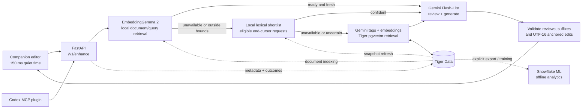

# Skill Issue

**Better prompts, while you type.** A companion editor for Codex with knowledge-grounded ghost text, clarifying questions, and an explicit handoff to your agent.

Skill Issue retrieves relevant skills, example prompts, and agent graphs, then asks Gemini to review their relevance and produce a suggestion. Accept a suffix with **Tab**, choose an edit from a question, or keep writing.

[](docs/assets/architecture.stl)

[Rotate the 3D model on GitHub](docs/assets/architecture.stl) · [Architecture guide](docs/architecture.md) · [Optional Three.js controls & running instructions](docs/architecture-view/README.md) · [API contract](docs/api.md) · [Codex plugin](docs/codex-plugin.md)

## What runs today

The source configuration is the reference for these defaults, updated **25 October 2026**. Model overrides can change a deployment; the diagram describes the code, not live service health.

| Layer               | Stack                                                                                                           | Role                                                                                                               |
| :------------------ | :-------------------------------------------------------------------------------------------------------------- | :----------------------------------------------------------------------------------------------------------------- |
| Companion editor    | Next.js **16.4.3**, React **19.3**, TypeScript, Tailwind CSS **4**, shadcn/ui + Radix, TanStack Query / Virtual | Refine, Knowledge, Activity, Settings; debounced requests and validated ghost text                                 |
| API & orchestration | Python, FastAPI, Pydantic, Psycopg 3                                                                            | Retrieval routing, combined review/generation, anchored edits, traces, outcomes, handoff                           |
| Local retrieval     | **Google EmbeddingGemma 2** + lexical fallback, quantized ONNX on CPU                                           | Up to three candidate documents from a fresh in-process Tiger snapshot; document vectors prepared outside requests |
| Generation          | Google Gen AI SDK; **`gemini-3.5-flash-lite`** by default                                                       | Fresh candidate relevance review and suffix/question generation in the same structured call                        |
| Semantic fallback   | Gemini tag extraction + **`gemini-embedding-001`**, **768 dimensions**                                          | Cached tag vectors and pgvector retrieval when local routes cannot serve the request                               |
| Source of truth     | **Tiger Data**: PostgreSQL, pgvector, TimescaleDB                                                               | Knowledge, tag vectors, settings, handoffs, outcomes, and metadata logs/traces                                     |
| Offline analytics   | **Snowflake ML Classification**                                                                                 | Export derived outcome features and train an acceptance classifier; outside the suggestion path                    |
| Codex integration   | Python **MCP** server + `prompt-enhance` skill, pooled HTTPX client                                             | `get_refined_prompt`, `enhance_prompt`, `search_knowledge`                                                         |

The local encoder is `onnx-community/embeddinggemma-2-ONNX`, pinned and checksum-verified by the installer. It requires the optional runtime and model files. Missing or unavailable local inference falls back to eligible lexical matching, then the existing remote route. Local retrieval **does not make generation offline**: Gemini still receives the draft and candidate context for review/generation.

## How a suggestion is made



- **Retrieve locally when possible.** Direct document/query semantic retrieval is preferred when its index is ready; eligible end-cursor autocomplete can fall back to a lexical shortlist. Neither is a relevance verdict.
- **Review every candidate afresh.** One Gemini call reviews the shortlist before producing an autocomplete suffix, a multiple-choice question with edits, or `none`. Invalid output gets one retry; invalid output twice becomes `none`.
- **Keep the editor correct while typing.** Requests debounce at 150 ms by default. Revision checks, cancellation, IME handling, exact-prefix ghost reuse, and bounded in-flight suffix adoption prevent unrelated stale output from appearing.
- **Keep slow work outside the request.** Document indexing, snapshot refreshes, trace persistence, and Snowflake export/training have separate roles. Snowflake does not select or generate suggestions.

This is a **single-user, single-worker** application. Process-local caches, invalidation, and pending trace reads need coordination before a multi-worker deployment. See [architecture](docs/architecture.md) for bounds and failure behavior.

## Run locally

Prerequisites: Python **3.12+**, `uv`, Node.js **20.9+**, `pnpm`, a Gemini API key, and a Tiger Data database supporting pgvector and TimescaleDB. Snowflake is needed for export/training, not for each suggestion.

1. Copy `.env.example` to `.env` and set `GEMINI_API_KEY` and `DATABASE_URL`. Keep credentials in the ignored `.env`; the helper prompts without echoing secrets:

   ```bash
   cp .env.example .env
   python3 scripts/set-secret.py GEMINI_API_KEY
   python3 scripts/set-secret.py DATABASE_URL
   ```

2. Install and start the backend. To include local EmbeddingGemma retrieval:

   ```bash
   cd backend
   uv sync --extra local-retrieval
   PYTHONPATH=. uv run --extra local-retrieval python scripts/setup_local_embeddings.py
   uv run --extra local-retrieval uvicorn app.main:app --host 127.0.0.1 --port 8000
   ```

   The explicit installer downloads approximately **346 MB** of pinned model/tokenizer artifacts. The running backend never downloads model files. For the base installation, use `uv sync` and `uv run uvicorn app.main:app --host 127.0.0.1 --port 8000`; the local encoder is optional. Migrations run at startup.

3. In another terminal, install and start the companion:

   ```bash
   cd frontend
   pnpm install
   pnpm dev
   ```

   Open [localhost:3000](http://localhost:3000). Load the repository's sample knowledge with:

   ```bash
   cd backend
   uv run --extra local-retrieval python -m app.knowledge.seed
   ```

4. Follow the [plugin installation guide](docs/codex-plugin.md) to enable **Send to Codex**. For analytics, configure the named Snowflake connection selected by `SNOWFLAKE_CONNECTION_NAME` (default `prompt-enhance`); see `scripts/snowflake-login.py`.

### Model and routing controls

| Environment variable        | Default                          | Effect                                                                     |
| :-------------------------- | :------------------------------- | :------------------------------------------------------------------------- |
| `TAG_MODEL`                 | `gemini-3.5-flash-lite`          | Tag extraction and knowledge analysis                                      |
| `AUTOCOMPLETE_MODEL`        | `gemini-3.5-flash-lite`          | Compact suffix generation                                                  |
| `GENERATE_MODEL`            | `gemini-3.5-flash-lite`          | Full suggestions; `gemini-3.6-flash` is an optional stronger configuration |
| `FAST_AUTOCOMPLETE_ENABLED` | `true`                           | Enables the lexical shortlist                                              |
| `DIRECT_SEMANTIC_ENABLED`   | `true`                           | Enables paired document/query retrieval                                    |
| `SEMANTIC_EMBED_BACKEND`    | `local`                          | `local` uses EmbeddingGemma; `gemini` uses remote paired embeddings        |
| `LOCAL_EMBEDDING_MODEL_DIR` | `backend/.cache/embeddinggemma2` | Verified local model files                                                 |

Set both routing flags to `false` to compare against the serial tag-based route. Source defaults live in [`backend/app/config.py`](backend/app/config.py).

## Evidence, tests, and data

The [performance report](docs/performance.md) records earlier measured runs, with their corpus and model settings. Those timings are not a fresh benchmark of the local semantic route. The local embedding probe measured retrieval separately; it is **not** evidence of end-to-end sub-500 ms suggestions.

```bash
# Backend: includes tests requiring configured real services
cd backend
uv run --extra local-retrieval pytest -q

# Frontend: unit/component checks, then real-browser journeys
cd ../frontend
pnpm test
pnpm typecheck
pnpm test:e2e

# Plugin: backend-dependent checks skip if the API is unavailable
cd ../plugin/prompt-enhance/mcp
uv run pytest -q
```

Operational logs contain metadata, not prompt bodies, knowledge bodies, or model responses. Logs and traces have 30-day TimescaleDB retention. Knowledge and explicit Codex handoffs **do** store content in Tiger; this logging policy is not a claim that the application stores no text.

## Explore the repository

| Path                                                 | Contents                                                          |
| :--------------------------------------------------- | :---------------------------------------------------------------- |
| [`frontend/`](frontend/)                             | Companion UI and browser tests                                    |
| [`backend/app/`](backend/app/)                       | API, pipeline, local embeddings, persistence, analytics           |
| [`backend/seed/`](backend/seed/)                     | Sample skills and coding guidance                                 |
| [`plugin/`](plugin/)                                 | Codex marketplace, MCP server, and skill                          |
| [`docs/architecture-view/`](docs/architecture-view/) | Self-contained Three.js scene, modeled components, route explorer |
| [`docs/architecture.md`](docs/architecture.md)       | Current implementation and correctness boundaries                 |
| [`docs/performance.md`](docs/performance.md)         | Historical measurements and reproduction commands                 |
| [`design.md`](design.md)                             | Companion visual system                                           |

The README embeds the architecture directly as a screenshot. Click it to rotate the geometry in GitHub’s native STL viewer; STL does not preserve colors or route controls. The optional minimal Three.js viewer adds colors, route buttons, and component descriptions; see the [viewer guide](docs/architecture-view/README.md).
