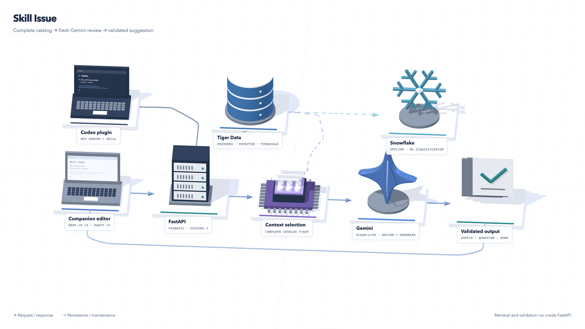

# Skill Issue architecture explorer

The repository README uses a flat technical architecture diagram as its main presentation. The 3D model is a secondary visualization you can rotate directly inside GitHub. This optional **Three.js r180** viewer contains only the scene, route buttons, and a short description. Select a model to open its source-backed details. It honors reduced motion, supports keyboard access through native buttons, and retains text/component navigation if WebGL is unavailable.

The viewer reflects `main` at `78e7821`: complete-catalog review first, then lexical, direct semantic, and tag/pgvector fallback. Local semantic retrieval is implemented and requires optional dependencies/model files. See the [backend pipeline overview](../architecture.md#backend-pipelines-at-a-glance) for ingestion, maintenance, handoff, feedback, and offline analytics.

The models are real procedural 3D meshes built in `models.js`: a companion laptop, FastAPI server rack, context-selection processor, Gemini symbol, validation documents, Codex terminal, Tiger database, and Snowflake symbol. They are conceptual models, not vendor-provided 3D assets. Retrieval and validation are responsibilities inside the API process, not extra deployed services.



## View locally

From the repository root:

```bash
python3 -m http.server 4310 --bind 127.0.0.1 --directory docs
```

Open [the interactive explorer](http://localhost:4310/architecture-view/). Use a local HTTP server rather than opening `index.html` via `file://`, because the scene imports JavaScript modules. No application backend, credentials, model download, CDN, or build step is required. Three.js and OrbitControls are vendored at the same pinned version, with the MIT license in `vendor/LICENSE.three`.

Choose a route to see its role and constraints. Select a mesh, label, or component button to inspect details and source links. Drag to orbit, scroll/pinch to zoom, and use **Reset view** to return. **Pause flow** stops the decorative request markers. Add `?still=1` for deterministic still captures; their speed is illustrative and does not represent measured service latency.

## On GitHub

The README links to [`architecture.stl`](../assets/architecture.stl) in **GitHub's native 3D viewer**, with rotation and zoom. The exported model includes raised geometry labels. STL is monochrome and does not preserve material colors, route controls, or descriptions. [GitHub's 3D viewer documentation](https://docs.github.com/en/repositories/working-with-files/using-files/working-with-non-code-files#3d-file-viewer).

GitHub sanitizes JavaScript from Markdown, so the optional Three.js controls run locally or on GitHub Pages. The viewer has no landing-page layout: it is just the diagram, controls, and contextual descriptions. [GitHub's Markdown rendering pipeline](https://github.com/github/markup), [GitHub Pages documentation](https://docs.github.com/en/pages/getting-started-with-github-pages/what-is-github-pages).

The repository includes [`.github/workflows/architecture-pages.yml`](../../.github/workflows/architecture-pages.yml). It stages only the viewer, its vendored dependency, and the screenshot; it does not publish the app, research evidence, or backend files.

To publish after committing the presentation:

1. In repository **Settings → Pages → Build and deployment**, select **GitHub Actions** as the source.
2. Run the manual **Publish architecture explorer** workflow from Actions on `main`.
3. After the workflow succeeds, use its deployment URL. The project is named **Skill Issue**; the existing repository URL still uses `Agentcomplete`. With that repository slug and no custom domain, the expected viewer URL is `https://mattlo0546.github.io/Agentcomplete/architecture-view/`.

That URL is an expected deployment location, not a claim that the site is already published. The README's technical diagram works independently of Pages. The workflow follows [GitHub's custom-workflow guidance](https://docs.github.com/en/pages/getting-started-with-github-pages/using-custom-workflows-with-github-pages).

## Update or recapture

- `data.js`: component facts, source links, route explanations, and visible model names.
- `models.js`: 3D meshes and materials; no third-party model files.
- `app.js`: scene, camera, flow edges, picking, route state, and fallback handling.
- `styles.css`: responsive layout and compact mobile labels.
- `export-stl.js`: geometry and raised-label export for the native GitHub viewer.
- `capture.mjs`: local browser smoke checks, diagram-only screenshot capture, and STL export.

Keep the viewer and [architecture guide](../architecture.md) aligned with `backend/app/config.py`, `backend/app/pipeline/run.py`, and the frontend request state. Model labels describe source defaults, not a live query of `.env` or provider availability.

With frontend dependencies and Playwright Chromium installed, start the static server above, then run from the repository root:

```bash
node docs/architecture-view/capture.mjs
```

The script checks all routes, component selection, orbit/reset, pause/resume, mobile layout, reduced motion, and the WebGL fallback. It overwrites `docs/assets/architecture.png` and `docs/assets/architecture.stl` and saves a mobile inspection image under `/tmp`. It does not call Gemini, Tiger, Snowflake, or the app API.
