# Agentcomplete — architecture and autocomplete performance

Updated 25 October 2026. The companion panel, Codex MCP plugin, Gemini, Tiger Data and Snowflake remain the stack. See [performance results](performance.md) for measured before/after results and [provider options](provider-latency-options.md) for research-only alternatives.

## Request path

```mermaid
flowchart LR
  Editor["Editor · 200 ms quiet time"] --> API["FastAPI /v1/enhance"]
  API --> Settings["Cached settings"]
  Settings --> Tags["Gemini tag extraction · exact-input cache"]
  Tags --> Retrieve["Cached embeddings + Tiger pgvector retrieval"]
  Retrieve --> Generate["Gemini: review every candidate, then generate"]
  Generate --> Validate["Validate suffix / anchored edits / UTF-16"]
  Validate --> Editor
  Validate -. "background metadata" .-> Trace["Trace + knowledge use counts"]
  Trace --> Tiger[("Tiger Data")]
  Tiger -. "outcomes / offline classifier" .-> Snowflake[("Snowflake")]
```



1. The editor waits **200 ms** after input stops. This is configurable from 150–1500 ms. Migration `002_autocomplete_delay.sql` moves the old 400 ms preset to 200 ms and retains other delay values.
2. `/v1/enhance` reads settings from a short process cache. Empty prompts and disabled modes skip model calls. Without a valid previous request, tag extraction and checking whether knowledge has tags run concurrently.
3. Tags still come from a small Gemini model. The browser sends the last validated `previous_request_id`, including valid `none` responses. That same tag call compares the previous and current drafts; explicit approval of an immaterial edit, unchanged normalized tags/task type, and fresh source data allow reuse of the previous candidates. Otherwise retrieval embeds those tags with `gemini-embedding-001` and uses Tiger Data's pgvector nearest-neighbour query. At most five candidates pass the 0.88 similarity cutoff.
4. One structured call **reviews every candidate summary and then generates**. The schema puts reviews before the suggestion; Python requires exactly one review for every candidate and enforces the keep-score threshold. This replaces a separate request per judge plus a later generation request. Each new prompt receives a fresh relevance review, even when retrieval is cached.
5. The existing tag call also classifies whether a continuation is needed, including partial words and other languages. Those drafts, obvious unfinished English clauses, or autocomplete-only mode use a small suffix schema at the end cursor. Complete or ambiguous drafts request a question or `none` so missing facts become explicit choices. Questions prefer two short options with one anchored edit each; Python creates option IDs and UTF-16 offsets. The public API still permits multiple edits and up to the configured maximum options.
6. Both paths use Gemini Flash-Lite by default, at minimal thinking. `GENERATE_MODEL=gemini-3.6-flash` restores the stronger question/general model; `AUTOCOMPLETE_MODEL` separately controls the suffix path. Tags, judging and generation stay with the same sponsor.
7. Output validation and one retry for invalid edits/reviews remain. Provider failures remain HTTP errors. No partially validated output is shown.
8. Validated trace metadata becomes readable immediately in process, then persists to Tiger with usage counts in the background. Immediate `/traces` and `/outcomes` reads can resolve pending traces. Shutdown and log clearing drain pending writes. A bounded trace queue applies backpressure if the database stalls; process failure before a background write commits can lose that metadata.

The unused speculative full generation has been removed. A fresh grounded request normally makes three provider calls (tags, embeddings, reviewed generation), compared with as many as nine previously. Cache hits can reduce this to a single generation call.

## Typing, cancellation and correctness

The browser aborts obsolete requests. The server listens for an ASGI disconnect and cancels the pipeline and child tasks, releasing local work/connections and avoiding later pipeline stages. Cancellation cannot guarantee that a provider stops billing inference already started remotely.

Network responses still require the latest request ID and prompt revision. Every text change increments the revision. A narrow local exception preserves an already validated ghost: if the user appends exactly the beginning of that visible suffix, at the collapsed end cursor, the remainder stays visible immediately without a request. Any divergent edit, deletion, selection or cursor move invalidates it. Outcomes retain the original suggestion's request ID and source revision; typing the entire suggestion counts as acceptance.

Ghost text paints without the old 120 ms fade. IME composition suppresses requests and Tab/Escape suggestion actions. Settings changes cancel old-mode work and remove disabled suggestion types. Settings arriving after typing starts preserve the queued request's original quiet-time timestamp. Draft storage is batched at 250 ms (one-second maximum wait), with navigation/unmount flushing.

The previous-response pointer stays in component memory and resets when the draft is cleared or the editor remounts. Failed, canceled, stale or invalid responses cannot replace it. Unknown/expired references trigger ordinary retrieval. Comparison occurs in the existing tag call, without adding a new inference round trip. Candidate relevance is always reassessed against the current text; an approval never reuses a previous verdict or suggestion.

Byte-identical linked drafts skip tag inference as well as retrieval while their context remains fresh. This covers cursor movement without changed text; generation still uses the current cursor, response-type settings and candidate review. The trace identifies this with `unchanged draft` in the tags step.

## Caches and freshness

All caches are bounded, process-local memory. No new payload logging or persistent prompt cache is introduced.

| Cache | Key / bound | Freshness |
|---|---|---|
| Settings | Singleton, copied for each caller | 5 seconds; API updates replace it immediately under the same lock |
| Tags and derived task features | Model + SHA-256 of full current/prior drafts and comparison options; 256 entries | 60 seconds; ordinary long inputs retain the first 4,000 and final 2,000 characters. A changed hidden middle disables reuse and extracts from the full current draft |
| Tag embeddings | Model + dimensions + tag; 1,024 entries | One hour; same semantic-similarity embedding task |
| Retrieved candidates | Embedding model/dimensions, normalized tag set and threshold; 128 entries | 15 seconds; create/edit/delete invalidates immediately after commit |
| Knowledge presence | Singleton | 15 seconds; same mutation invalidation |
| Previous draft context | Completed request ID; 128 entries | At most 15 seconds from the original candidate SQL read, never renewed by subsequent edits; model changes and knowledge mutations invalidate reuse |
| Pending trace metadata | Request ID, at most 256 pending writes | Available until persistence completes |

Knowledge invalidation advances a generation counter so an older in-flight read cannot repopulate a cleared cache. Relevance verdicts and completed responses are not reused across different drafts. Writes made externally or through another process become visible within the cache TTL.

This is the existing single-user, single-worker topology. Pending-trace reads and invalidation assume that topology; multiple workers require shared cache/invalidation and trace handoff before deployment.

## Models and transport

| Operation | Default |
|---|---|
| Tags / knowledge analysis | `gemini-3.5-flash-lite` |
| Suffix and full enhancement | `gemini-3.5-flash-lite` |
| Embeddings | `gemini-embedding-001`, 768 dimensions |
| Optional stronger full enhancement | `GENERATE_MODEL=gemini-3.6-flash` |

Generation output budgets are 768 tokens for compact suffixes and 2,048 for full suggestions; tags use 512. Minimal thinking reduces unnecessary reasoning, but output budgets still leave room for valid structured JSON. The existing Gemini client is reused. The MCP server now also reuses an HTTPX client through its lifespan.

Tiger remains the source of truth in us-east-1. Snowflake export/training stays off the suggestion path. No database region, provider endpoint, authentication or sponsor integration has been changed.

## Inspect and reproduce

Important files:

- `backend/app/pipeline/complete.py`: small response schemas, candidate review, model routing.
- `backend/app/pipeline/run.py`: orchestration and validation.
- `backend/app/pipeline/{tags,retrieve,cache,context}.py`: caches, draft comparison and retrieval.
- `backend/app/api/enhance.py`: disconnect cancellation.
- `backend/app/pipeline/trace.py`: asynchronous metadata persistence.
- `frontend/src/lib/enhance/{use-enhance,state}.ts`: debounce, stale-response safety and local suffix reuse.
- `plugin/prompt-enhance/mcp/prompt_enhance_mcp/{client,server}.py`: pooled plugin transport.

From `backend/`, measure the running backend with real credentials/services:

```bash
PYTHONPATH=. uv run python scripts/bench_enhance.py --base-url http://127.0.0.1:8000 --rounds 2 --output /tmp/latency.json
PYTHONPATH=. uv run python scripts/bench_enhance.py --base-url http://127.0.0.1:8000 --incremental
PYTHONPATH=. uv run python scripts/bench_enhance.py --base-url http://127.0.0.1:8000 --incremental --previous-context
```

The script records metadata only: fixture case number, timings, result type, model, review counts and errors. Round one is first visit; round two repeats exact inputs. This is distinct from typing new text, which requires new tags/review unless already computed. `--previous-context` chains successful response IDs through the incremental fixtures and records explicit candidate reuse. `--cases 7 8 9` selects the suffix fixtures. Omitting `--base-url` measures the pipeline in process.

The Activity timeline records actual AI calls. Logical `judge` trace time is zero when it shares generation's call; its detail and model make that explicit. Warm cached tag/retrieval stages can also report zero time. These figures must not be added as if shared stages were separate calls.

Contract tests cover bounds, surrogate pairs, edit anchoring, per-candidate reviews, upstream failures, cache invalidation, cancellation and immediate trace reads. Browser tests cover real provider suggestions, accept/decline, diff application, settings, knowledge and Codex handoff.
