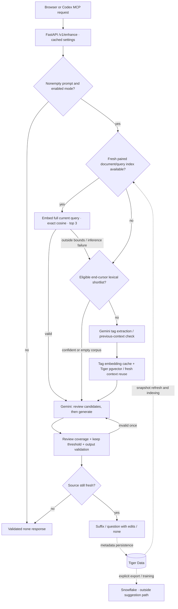

# Agentcomplete architecture

Implementation snapshot: **25 October 2026**. This guide follows the current source defaults, including optional local EmbeddingGemma retrieval and bounded in-flight suffix adoption. Historical measurements live in [performance.md](performance.md); older research documents describe experiments, not necessarily the current request path.


[Run and explore the interactive model](architecture-view/README.md). The models represent logical components: retrieval and validation run inside the FastAPI process, not as separately deployed services.

## Runtime and ownership

| Component                              | Responsibility                                                             | Source                                                          |
| :------------------------------------- | :------------------------------------------------------------------------- | :-------------------------------------------------------------- |
| Next.js 16 / React 19 companion        | Refine, Knowledge, Activity, Settings; HTTP API client                     | `frontend/src/`                                                 |
| FastAPI / Pydantic / Psycopg 3         | Request routing, validation, database access, cancellation                 | `backend/app/main.py`, `backend/app/api/`                       |
| Local lexical + semantic retrieval     | Nominate candidates from a fresh Tiger snapshot                            | `backend/app/pipeline/{catalog,semantic}.py`                    |
| Google EmbeddingGemma 2 / ONNX Runtime | Optional CPU query/document encoder; 768-dimensional normalized vectors    | `backend/app/llm/local_embeddings.py`                           |
| Gemini / Google Gen AI SDK             | Knowledge analysis, fallback tagging/embedding, fresh review + generation  | `backend/app/llm/gemini.py`, `backend/app/pipeline/complete.py` |
| Tiger Data / PostgreSQL                | Authoritative knowledge, settings, handoffs, tag vectors, traces, outcomes | `backend/app/db/migrations/`                                    |
| pgvector / TimescaleDB                 | Tag similarity queries; time-series logs/traces with retention             | `backend/app/db/migrations/001_init.sql`                        |
| Snowflake ML Classification            | Explicit derived-feature export and offline acceptance-classifier training | `backend/app/analytics/`                                        |
| MCP server + Codex skill               | Refined-prompt handoff, direct enhancement, knowledge lookup               | `plugin/prompt-enhance/`                                        |

The application assumes **one user and one backend worker**. The local vector index, caches, invalidation counters, and pending trace registry are process-local. Multi-worker deployment requires shared invalidation and trace coordination. The diagram is a logical architecture map, not a cluster deployment plan.

## Ordered request routing



1. **Schedule.** The browser requests after 150 ms of quiet time by default (configurable from 150–1500 ms). It sends the entire draft, UTF-16 cursor position, request ID, revision, and the last validated previous request ID. A valid `none` response can also advance that pointer.
2. **Short-circuit.** Empty drafts or disabled modes skip inference. Settings are cached with background refresh and a hard expiry.
3. **Prefer direct semantic retrieval.** With `DIRECT_SEMANTIC_ENABLED=true`, a fresh paired document/query index is tried first, including for mid-cursor requests. By default, Google's EmbeddingGemma 2 runs locally through quantized ONNX on CPU. The entire eligible draft is embedded; exact cosine ranking nominates up to three documents. The best-matching bounded source chunk accompanies each candidate into generation. This ranking has no borrowed 0.88 tag threshold and does not decide relevance. `SEMANTIC_EMBED_BACKEND=gemini` switches this index to remote `RETRIEVAL_DOCUMENT` / `RETRIEVAL_QUERY` embeddings.
4. **Try lexical nomination if needed.** If direct retrieval cannot serve the request, `FAST_AUTOCOMPLETE_ENABLED=true`, autocomplete is enabled, and the cursor is at the end, a bounded Tiger snapshot can nominate up to three candidates. Title/summary/tag overlap is required; body terms contribute to ranking. Unknown or ambiguous shared-topic matches proceed to the remote route.
5. **Fall back to tags and pgvector.** If neither local route serves the request, Gemini extracts tags and can compare a previous draft in the same call. Approved immaterial changes, unchanged tags/task type, and fresh sources permit candidate reuse. Otherwise `gemini-embedding-001` embeds tags with `SEMANTIC_SIMILARITY`; Tiger pgvector returns at most five candidates passing the 0.88 tag threshold. Tag extraction and knowledge-presence lookup run concurrently when no previous context is available.
6. **Review and generate together.** A single structured Gemini call reviews every candidate before generating. Python requires complete review coverage, a true keep decision, and an unrounded score of at least 0.5. Compact suffix requests and full question/general requests use different schemas. Every newly generated suggestion gets fresh review, even when retrieval is cached.
7. **Validate.** Output types, suffix bounds, option limits, anchored edits, UTF-16 offsets, and source freshness are checked. Invalid output/reviews get one retry; invalid output twice returns `none`. Provider failures remain HTTP errors. A snapshot that changes or expires during generation causes the suggestion to be discarded.
8. **Record.** Trace metadata is immediately readable in process and persists with usage counts to Tiger in the background. Outcomes record how the user reacted. Snowflake export and training are explicit operations outside the request.

A warm lexical route uses one remote generation/review call. A warm local semantic route adds local query inference before that call. The fallback can require three serial provider calls (tags, embedding, reviewed generation), reduced by caches. Model retries and source refreshes add work; one call is not a latency guarantee.

## Local semantic index

The encoder is `onnx-community/embeddinggemma-2-ONNX`, revision `daa72c51243991dfcaf9f9137d2c573d8f7790c0`, with quantized model artifacts, CPU execution, and 768-dimensional normalized vectors. The explicit setup script verifies artifact sizes and SHA-256 hashes. Runtime model loading verifies them again. No runtime download occurs.

Document vectors are prepared at startup and on background snapshot refresh. Their keys include model/configuration, task, title, and content hash. The index publishes only for a complete, current snapshot; changed/deleted documents cannot inherit stale vectors. A cold build may outlast source freshness, so valid content-addressed vectors can be reused after a fresh Tiger read. They are not a second authoritative store or a persisted pgvector document index.

Current conservative limits in `semantic.py`:

- At most **256 documents**, **2,000,000 source characters**, and **4,096 chunks**.
- The catalog currently prefetches up to **8,000 body characters per document** (plus title, summary, and tags). Document chunks preserve all text in that snapshot representation, splitting at Unicode boundaries with **1,800 UTF-8 bytes** per chunk.
- Queries larger than **1,800 UTF-8 bytes** fall back; they are not silently truncated.
- Local tokenizer input is bounded to **8,192 tokens** after search prefixes. Native inference runs off the async event loop, serialized, with at most **four pending jobs**.
- Missing optional packages/model files, a warming or stale index, bounds violations, a busy encoder, and inference failures preserve the existing fallback.

The local model is optional, but selected by default when installed. Generation remains remote. Switching the direct embedding backend to Gemini also sends document/query text to the embedding API.

## Typing and cancellation

Every text change advances the prompt revision. Exact responses must match their pending request and pass response validation. Cursor/selection changes, destructive edits, IME composition, backend/settings changes, and invalid responses prevent unrelated output from being adopted.

Two narrow optimizations preserve a useful suffix:

- **Visible ghost reuse:** appending exactly the start of an already validated suffix immediately reveals its remainder. Divergent edits invalidate it; typing the entire suffix counts as acceptance.
- **In-flight suffix adoption:** uninterrupted end-cursor typing can retain at most one older request alongside the current one. A response arriving within **3 seconds** of its start can contribute only a validated autocomplete suffix when the newly typed text exactly matches its prefix, the remainder is nonempty, and UTF-16 code points remain intact. Questions and unrelated old responses are not adopted. Original request/revision attribution is preserved for outcomes.

Other obsolete browser requests are aborted. The API watches for disconnect and cancels pipeline/child tasks. Canceling local work cannot guarantee that a remote provider stops already-started inference; native ONNX inference can also finish after caller cancellation, while retaining its serialization lock.

Ghosts paint without the old fade. IME suppresses requests and Tab/Escape suggestion actions. Draft storage is batched at 250 ms with a one-second maximum wait and flushes on navigation/unmount. The previous-response pointer is component memory, cleared on empty draft/remount.

## Freshness and caches

| Data                                          | Lifetime / boundary                                                                             |
| :-------------------------------------------- | :---------------------------------------------------------------------------------------------- |
| Settings                                      | Refresh every 2.5 seconds; five-second hard expiry                                              |
| Tiger knowledge snapshot                      | Refresh every 10 seconds; 15-second source expiry; knowledge mutations invalidate               |
| Direct document index                         | Must align with current snapshot, generation, and embedding configuration                       |
| Direct query vectors                          | Exact text + configuration + task; 256 entries, one-hour TTL                                    |
| Tag extraction                                | Exact input/model; 256 entries, one-minute TTL                                                  |
| Tag embeddings                                | Model + dimensions + normalized tag; 1,024 entries, one-hour TTL                                |
| Retrieved tag candidates / knowledge presence | 15 seconds; invalidated after committed knowledge mutations                                     |
| Previous draft context                        | 128 entries; no more than 15 seconds from original retrieval, never renewed by subsequent edits |
| Pending trace metadata                        | Up to 256 pending writes; readable until persistence completes                                  |

Invalidation advances a generation counter so older in-flight reads cannot refill cleared caches. Failed refreshes do not renew freshness. External writes become visible within the refresh/expiry window. Process failure before a background trace write commits can lose pending metadata; the bounded queue applies backpressure when the database stalls.

## Models and data boundaries

| Operation                                     | Source default                                                       |
| :-------------------------------------------- | :------------------------------------------------------------------- |
| Tag extraction / knowledge analysis           | `gemini-3.5-flash-lite`                                              |
| Candidate review + compact suffix             | `gemini-3.5-flash-lite` (`AUTOCOMPLETE_MODEL`)                       |
| Candidate review + full suggestion            | `gemini-3.5-flash-lite` (`GENERATE_MODEL`)                           |
| Optional stronger full suggestion             | `GENERATE_MODEL=gemini-3.6-flash`                                    |
| Local direct document/query embeddings        | EmbeddingGemma 2 ONNX, 768 dimensions                                |
| Remote paired embedding option + tag fallback | `gemini-embedding-001`, 768 dimensions; different task types/indexes |

Suffix output budgets are 768 tokens; full suggestions 2,048; tags 512. The configured generation path uses minimal thinking. `judge_model` remains a configuration field for standalone judging; the active combined pipeline reviews with the selected generation model.

Logs/traces keep metadata for 30 days, without raw prompt, knowledge body, or model response text. Knowledge and explicit handoff prompts are content-bearing Tiger records. Gemini receives the input needed for analysis/generation; local embeddings do not remove that boundary. Snowflake receives derived outcome features rather than prompt bodies.

## Handoff and analytics

**Send to Codex** stores a refined prompt through `/v1/handoff`. The Codex `prompt-enhance` MCP plugin fetches the latest handoff with `get_refined_prompt`; it also exposes `enhance_prompt` and `search_knowledge`. This is a separate companion and explicit handoff, not an injected Codex composer widget.

Snowflake export reads outcome features from Tiger. Training uses the latest decisive event per request, requires at least 20 labeled requests with both classes, and reports evaluation metrics back to the application. The classifier does not currently gate suggestions, select retrieval candidates, or automatically retrain on every outcome.

## Verify and reproduce

The [root setup instructions](../README.md#run-locally) include the optional local model installation. Tests and probe results must be read with their exact environment, corpus, and route flags; earlier lexical-only measurements do not establish current semantic-route end-to-end latency.

From `backend/`, with the real services configured and API running:

```bash
PYTHONPATH=. uv run --extra local-retrieval python scripts/bench_enhance.py --base-url http://127.0.0.1:8000 --rounds 2 --output /tmp/latency.json
PYTHONPATH=. uv run --extra local-retrieval python scripts/bench_enhance.py --base-url http://127.0.0.1:8000 --incremental --previous-context
```

`frontend/scripts/bench-latency.mjs` measures input-to-visible latency in a browser. Provider or embedding latency alone excludes debounce, retrieval, validation, transport, and paint. The Activity timeline represents actual calls: judging shares generation, so its logical stage time must not be added as a separate inference call.
