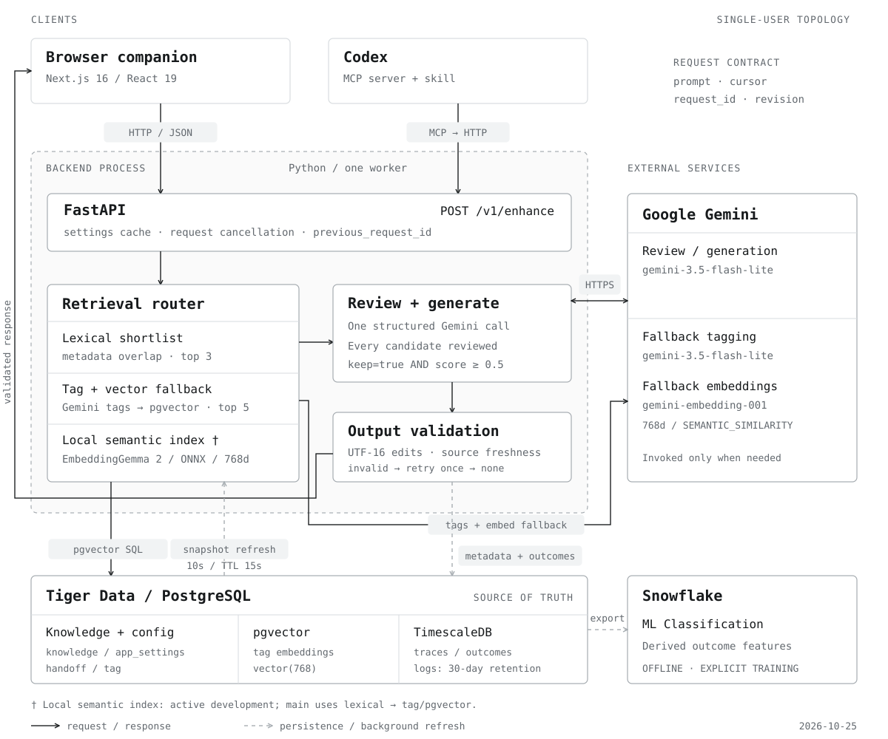
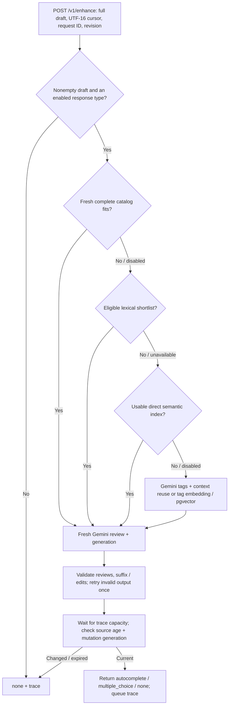
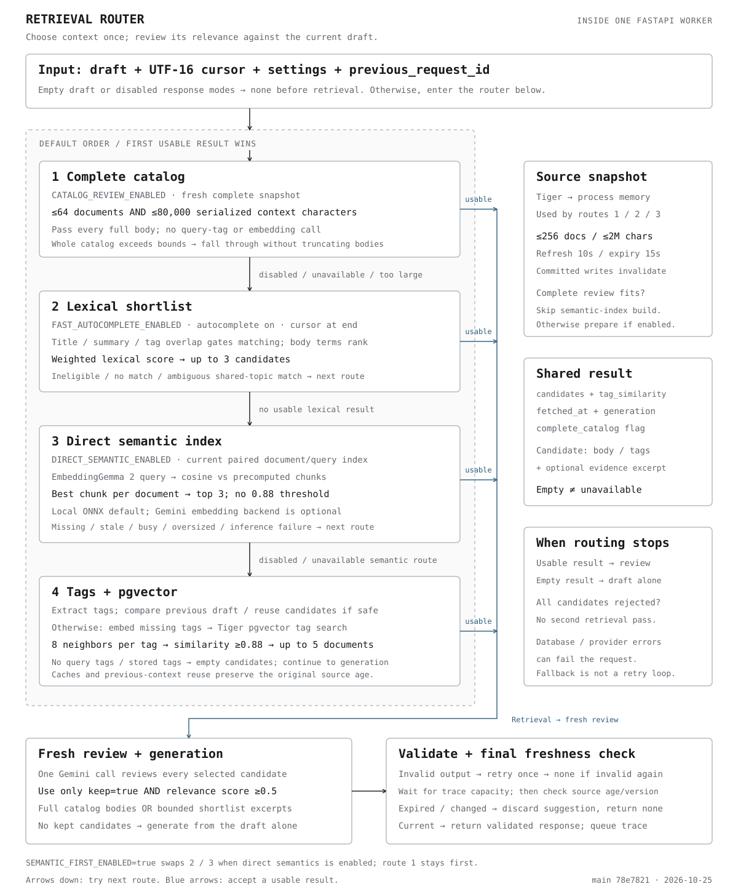
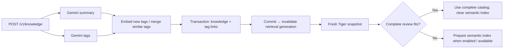
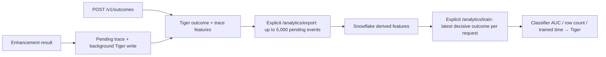

# Skill Issue architecture

Source snapshot: **25 October 2026**, verified against GitHub `main` at [`78e7821`](https://github.com/Mattlo0546/Agentcomplete/commit/78e7821315ba6063ed27561743892ffa1846dbe5). The default route reviews the **complete bounded catalog**. Lexical, direct semantic, and tag/pgvector retrieval provide fallbacks. Local semantic retrieval and bounded in-flight suffix adoption are implemented on `main`; local embeddings require optional runtime/model installation. These are source defaults, not a check of deployed environment overrides or provider health. [Performance measurements](performance.md) retain their original corpus and settings.

<picture>
  <source media="(prefers-color-scheme: dark)" srcset="assets/architecture-technical-dark.svg">
  
</picture>

The diagram separates the API process from Gemini, Tiger, and Snowflake. It is generated from [render_architecture.py](diagrams/render_architecture.py).

[System overview](#runtime-and-ownership) · [Backend pipelines](#backend-pipelines-at-a-glance) · [Retrieval router deep dive](#retrieval-router)

## Runtime and ownership

| Component                      | Responsibility                                                      | Source                                                                                            |
| :----------------------------- | :------------------------------------------------------------------ | :------------------------------------------------------------------------------------------------ |
| Next.js 16 / React 19          | Refine, Knowledge, Activity, Settings; HTTP client and editor state | [`frontend/src/`](../frontend/src/)                                                               |
| FastAPI / Pydantic / Psycopg 3 | Routing, validation, cancellation, database access                  | [`backend/app/`](../backend/app/)                                                                 |
| In-process catalog / semantic index | Supply the complete catalog or nominate a bounded shortlist | [`catalog.py`](../backend/app/pipeline/catalog.py), [`semantic.py`](../backend/app/pipeline/semantic.py) |
| Gemini / Google Gen AI SDK     | Analysis, fallback tags/embeddings, combined review and generation  | [`gemini.py`](../backend/app/llm/gemini.py), [`complete.py`](../backend/app/pipeline/complete.py) |
| Tiger Data / PostgreSQL        | Knowledge, settings, handoffs, tag vectors, traces, outcomes        | [`migrations/`](../backend/app/db/migrations/)                                                    |
| pgvector / TimescaleDB         | Tag similarity search; time-series logs/traces and retention        | [`001_init.sql`](../backend/app/db/migrations/001_init.sql)                                       |
| Snowflake ML Classification    | Explicit feature export and offline acceptance-classifier training  | [`analytics/`](../backend/app/analytics/)                                                         |
| MCP server + Codex skill       | Refined-prompt handoff, direct enhancement, knowledge lookup        | [`plugin/prompt-enhance/`](../plugin/prompt-enhance/)                                             |

The application assumes **one user and one backend worker**. Caches, invalidation counters, and pending trace reads are process-local. Multi-worker deployment requires shared invalidation and trace coordination.

## Backend pipelines at a glance

| Pipeline | Entry point | Processing and result | Source |
| :--- | :--- | :--- | :--- |
| Suggestion | `POST /v1/enhance` | Settings → context selection → fresh review + generation → validation → response and trace | [`run.py`](../backend/app/pipeline/run.py) |
| Knowledge ingestion | `POST /v1/knowledge` (SSE), `PATCH` / `DELETE /v1/knowledge/{id}` | Summary + tags → new tag vectors → transactional save → retrieval invalidation | [`ingest.py`](../backend/app/knowledge/ingest.py), [`knowledge.py`](../backend/app/api/knowledge.py) |
| Snapshot / index maintenance | Startup and every 10 seconds | Read bounded Tiger snapshot → publish current catalog → prepare semantic vectors only when complete review cannot serve | [`catalog.py`](../backend/app/pipeline/catalog.py) |
| Codex handoff | `POST /v1/handoff`, MCP `get_refined_prompt` | Store latest prompt → fetch through `GET /v1/handoff/latest` | [`handoff.py`](../backend/app/api/handoff.py) |
| Diagnostics / feedback | `GET /v1/traces/{request_id}`, `POST /v1/outcomes` | Read pending or persisted trace; join reactions to derived features and store outcomes | [`trace.py`](../backend/app/pipeline/trace.py), [`outcomes.py`](../backend/app/api/outcomes.py) |
| Offline analytics | `POST /v1/analytics/export`, `POST /v1/analytics/train` | Tiger outcome features → Snowflake export → classifier → evaluation metadata in Tiger | [`analytics/`](../backend/app/analytics/) |

## Suggestion pipeline

The orchestration lives in [`run.py`](../backend/app/pipeline/run.py). Route selection stops at the first usable result; an empty catalog is usable and leads to draft-only generation.



The graph shows default ordering. `SEMANTIC_FIRST_ENABLED=true` swaps lexical and semantic attempts **after** complete-catalog review. Provider failures remain HTTP errors; source reads can also fail. Only unavailable semantic inference/index preparation explicitly preserves the later routes.

1. **Schedule and validate input.** The editor waits for 150 ms of quiet time by default, configurable from 150–1500 ms. It sends the entire draft, UTF-16 cursor position, request ID, revision, and last validated previous request ID. FastAPI validates bounds, watches disconnects, and cancels obsolete pipeline tasks. Empty drafts or disabled response modes skip inference.
2. **Select context.** Settings and a versioned Tiger snapshot choose one of the routes below. Retrieval supplies candidates; it never substitutes for the current draft's relevance review.
3. **Review and generate together.** One structured Gemini call emits one strict `keep` boolean and numeric score per candidate, then a suffix, a multiple-choice question with anchored edits, or `none`. Python requires full review coverage and `keep=true` with an unrounded score ≥ 0.5. With no candidates, generation uses the draft alone. Compact suffix and full proposal schemas use different output budgets. Grammatically complete drafts can still receive a useful continuation.
4. **Validate and check freshness.** Python validates response types, partial-word spacing, suffix limits, option limits, anchors, and UTF-16 edits. Invalid output gets one retry; invalid twice returns `none`. After waiting for trace-queue capacity, the pipeline checks source age and the mutation generation counter. Any expired or changed retrieval is discarded.
5. **Record and return.** Trace metadata is immediately readable in process and persists with knowledge usage counts in the background. Browser reactions arrive separately through `/v1/outcomes`. Trace queue backpressure can delay a response; persistence is not guaranteed before return.

## Retrieval router

The router in [`run_enhance`](../backend/app/pipeline/run.py) chooses one context source for each request. Retrieval is an in-process responsibility; Tiger remains the source of truth. The diagram below expands the context-selection box in the system overview.

<picture>
  <source media="(prefers-color-scheme: dark)" srcset="assets/retrieval-router-dark.svg">
  
</picture>

### Retrieval order and bounds

| Order | Route | Conditions and context | Remote retrieval work before generation |
| :--- | :--- | :--- | :--- |
| 1 | Complete catalog | `CATALOG_REVIEW_ENABLED=true`; fresh complete snapshot; ≤64 items and ≤80,000 serialized knowledge characters, including wrappers and metadata. All bodies are supplied without per-item truncation. An oversized catalog falls through as a whole. | None |
| 2 | Lexical shortlist | `FAST_AUTOCOMPLETE_ENABLED=true`; autocomplete enabled; cursor at end. Title/summary/tag overlap nominates up to 3 documents; body terms affect ranking. Unknown or ambiguous matches fall through. | None |
| 3 | Direct semantic | `DIRECT_SEMANTIC_ENABLED=true`; current paired document/query index. Exact cosine ranks up to 3 documents and preserves their best matching chunk. No 0.88 tag threshold is applied. | None with local encoder; query embedding on cache miss with Gemini backend |
| 4 | Tags / pgvector | Extract tags; reuse previous candidates only after approved immaterial change, unchanged tags/task type, and current sources. Otherwise embed tags, query up to 8 neighbors per tag, and keep up to 5 linked documents with tag similarity ≥0.88. | Tag inference, then missing tag embeddings; caches can eliminate work |

Source defaults in [`config.py`](../backend/app/config.py): catalog review, fast autocomplete, and direct semantic are **enabled**; semantic-first is **disabled**; semantic embedding backend is **local**. A complete catalog that fits skips document-index preparation altogether. Snapshot bounds (256 documents / 2,000,000 source characters) are distinct from the stricter complete-review bounds. Exceeding snapshot bounds prevents both lexical and direct semantic selection, leaving the tag route.

The tag route runs extraction and the knowledge-tag presence lookup concurrently when no reusable previous draft exists. Reuse never skips fresh review. Full-catalog context contains every body; shortlist context uses a 6,000-character body budget, with 1,200-character excerpts or the selected semantic chunk (up to 1,800 characters).

A warm complete-catalog or lexical route normally uses **one remote review/generation call**. Local semantic retrieval adds local query encoding on cache miss. Remote semantic retrieval adds a query embedding call; index construction is separate. A cold tag route can require three serial provider calls: tags, embedding, and review/generation. Retries, refreshes, catalog size, and queueing affect latency; one call is not a subsecond guarantee.

### How each route selects context

**1. Complete catalog — coverage before ranking.** [`catalog.select_complete()`](../backend/app/pipeline/catalog.py) obtains a complete current snapshot, then checks its size with the same [`complete_knowledge_context()`](../backend/app/pipeline/generate.py) serializer used to construct the model input. The 80,000-character bound includes titles, summaries, bodies, wrappers, indices, and separators. If it fits, every document is copied into the result with `complete_catalog=true`; no query-word overlap or vector score can exclude a document. If it does not fit, the whole route falls through. A fitting catalog also skips semantic-index preparation, because the first route already has every source available for review.

**2. Lexical — metadata-supported term ranking.** [`catalog.select()`](../backend/app/pipeline/catalog.py) normalizes Unicode/case, removes stop words, and applies conservative stemming. Tags, title, summary, and body contribute weights of 4, 3, 2, and 0.5 per term. A candidate must overlap the query in its title, summary, or tags; body-only overlap cannot nominate it. Ranking sums `IDF(term) × weight / (weight + 1.2)` over matching terms and returns up to three documents. An unfinished final token of at least three characters can match known term prefixes. When more than three candidates exist and the leading four rely on the same single metadata term, the route declines to choose among them and falls through. These lexical scores are not cosine similarities or relevance verdicts.

**3. Direct semantic — rank document evidence by meaning.** [`semantic.select()`](../backend/app/pipeline/semantic.py) requires an index tied to the current source snapshot and encoder configuration. Document chunks are embedded during index preparation; a request computes or reuses its query vector, compares it with all indexed chunks, and ranks each document by its best chunk's cosine similarity. The top three documents retain that chunk as `evidence_excerpt`. The default encoder is optional local EmbeddingGemma 2 on CPU; `SEMANTIC_EMBED_BACKEND=gemini` uses paired remote document/query embeddings. There is no fixed 0.88 cutoff on this route. Missing dependencies, unavailable/stale indexes, queries over 1,800 UTF-8 bytes, queue saturation, and inference errors let later routes run. See [direct semantic retrieval](#direct-semantic-retrieval) for chunk/index bounds and installation.

**4. Tags / pgvector — retrieve through the tag graph.** [`extract_tags()`](../backend/app/pipeline/tags.py) supplies task features and tags. With no valid previous context, tag extraction and the stored-tag-presence lookup run concurrently. If tags exist on both sides, [`retrieve()`](../backend/app/pipeline/retrieve.py) embeds missing query tags with `gemini-embedding-001`, then issues one SQL query: find up to eight nearest stored tags per query tag, retain matches at cosine similarity ≥0.88, join `knowledge_tag`, and return up to five documents ranked by their best tag match. The SQL fetches at most the first 8,000 body characters per document; generation subsequently selects bounded excerpts. No extracted tags, no stored tags, or no qualifying matches yields an empty candidate list.

### Previous-draft reuse and cache validity

Previous-draft reuse belongs to the **tag route**, after the catalog, lexical, and semantic attempts. [`context.py`](../backend/app/pipeline/context.py) remembers completed tag-route requests only when they have candidates and current sources. The caller's `previous_request_id` can retrieve that context if its model fingerprint still matches and its original retrieval is fresh.

An unchanged draft can reuse its tag extraction without another tag-model call. For changed drafts, the tag model compares the drafts and must explicitly approve reuse. Python also requires a valid visible comparison, the same tag set, and the same task type. If a long draft changes in a middle section omitted from the comparison, reuse is vetoed and tags are extracted from the full current draft. Any veto triggers refreshed retrieval. Reusing candidates preserves `fetched_at` and `generation`, and every request still performs fresh relevance review. Embedding caches can outlive source snapshots because a cached vector does not establish that its knowledge source is still current.

### The shared result and stopping rules

All four routes converge on [`Retrieval`](../backend/app/pipeline/retrieve.py):

| Field | Role in the next stage |
| :--- | :--- |
| `candidates` | Knowledge ID, kind, title, summary, body, similarity, matched tags, and optional semantic evidence excerpt. The candidate list may be empty. |
| `tag_similarity` | Query-tag match scores for the tag route; empty for complete-catalog, lexical, and direct semantic results. |
| `complete_catalog` | Selects full-body serialization instead of shortlist excerpts. |
| `fetched_at`, `generation` | Preserve original source age and the committed-mutation version across reuse and cache hits. |

| Condition | Router / pipeline behavior |
| :--- | :--- |
| Route returns `None` | Try the next enabled, eligible route. |
| Route returns `Retrieval(candidates=[])` | Stop routing; generation uses the draft alone. An empty knowledge catalog is a usable result. |
| Reviewer rejects every candidate | Generate from the draft alone or return `none`; do not run another retrieval pass. |
| Semantic index/inference is unavailable | Fall through to the remaining route(s); with semantic-first, eligible lexical matching is still next. |
| Tiger read or tag/generation provider fails | Request can fail through the API error handling; fallback is not a universal error-retry loop. |
| Source changes or expires during generation | After trace backpressure clears, discard the suggestion and return `none`. |
| Output is structurally invalid | Retry review/generation once with validation feedback, using the same candidates; invalid twice returns `none`. |

The final freshness check requires the same mutation generation and an age below 15 seconds. Committed knowledge/tag mutations advance the process-local generation; older reads cannot republish a valid snapshot. External changes become visible through periodic refresh/expiry. This coordination assumes one worker; multiple workers would need shared invalidation. The [cache table](#freshness-and-caches) lists each cache's lifetime.

## Typing and cancellation

Every text change advances the revision. Responses must match the pending request and pass validation. Cursor changes, destructive edits, IME composition, settings changes, and invalid responses prevent unrelated output from being adopted. Obsolete browser requests are aborted; the API watches for disconnects and cancels pipeline tasks. Canceling local work cannot guarantee that a provider stops already-started inference.

Typing exactly the beginning of an already validated ghost suffix reveals its remainder immediately. Divergent edits invalidate it; typing the full suffix counts as acceptance. IME suppresses requests and Tab/Escape suggestion actions. Draft storage is batched at 250 ms with a one-second maximum wait and flushes on navigation/unmount. The previous-response pointer is component memory, cleared on empty draft/remount.

Uninterrupted end-cursor typing can retain one older request alongside the current request. A response within three seconds can contribute a validated autocomplete suffix only when new text exactly matches its prefix, the remainder is nonempty, and UTF-16 code points remain intact. Questions and unrelated old responses are not adopted. Original request/revision attribution is preserved for outcomes.

## Freshness and caches

| Data                                | Lifetime / boundary                                                   |
| :---------------------------------- | :-------------------------------------------------------------------- |
| Settings                            | 2.5-second refresh; five-second hard expiry                           |
| Tiger knowledge snapshot            | 10-second refresh; 15-second source expiry; mutations invalidate      |
| Tag extraction                      | Exact input/model; 256 entries; one-minute TTL                        |
| Tag embeddings                      | Model, dimensions, normalized tag; 1,024 entries; one-hour TTL        |
| Semantic query vectors              | Content/config/task key; 256 entries; one-hour TTL; source freshness checked separately |
| Semantic document vectors           | Content-addressed; reusable after a fresh source read; only a complete current index publishes |
| Tag candidates / knowledge presence | 15 seconds; invalidated after committed knowledge mutations           |
| Previous draft context              | 128 entries; 15 seconds from original retrieval, not renewed by edits |
| Pending trace metadata              | Up to 256 pending writes; readable until persistence completes        |

Invalidation advances a generation counter so older reads cannot refill cleared caches. Failed refreshes do not renew freshness. External writes become visible within the refresh/expiry window. Process failure before a background trace write commits can lose pending metadata; a bounded queue applies backpressure when the database stalls.

## Models and data boundaries

| Operation                           | Source default                                                |
| :---------------------------------- | :------------------------------------------------------------ |
| Draft tag extraction | `gemini-3.5-flash-lite` (`TAG_MODEL`) |
| Knowledge summary / tag generation | `gemini-3.5-flash-lite` (`JUDGE_MODEL`) |
| Review + compact suffix             | `gemini-3.5-flash-lite` (`AUTOCOMPLETE_MODEL`)                |
| Review + full suggestion            | `gemini-3.5-flash-lite` (`GENERATE_MODEL`)                    |
| Tag embeddings                      | `gemini-embedding-001`, 768 dimensions, `SEMANTIC_SIMILARITY` |
| Direct document / query embeddings | Local EmbeddingGemma 2 by default; optional Gemini `RETRIEVAL_DOCUMENT` / `RETRIEVAL_QUERY` |

Overrides live in [`config.py`](../backend/app/config.py). Suffix output budgets are 768 tokens; full suggestions 2,048; tags 512. Generation uses minimal thinking. `judge_model` is used for knowledge analysis and standalone judging; the active suggestion pipeline reviews with the selected generation model. The trace's logical `judge` step does not represent another inference call.

Logs and traces keep metadata for 30 days without raw prompt, knowledge body, or model-response text. Knowledge and explicit handoff prompts are content-bearing Tiger records. Gemini receives the draft and candidate context required for generation. Snowflake receives derived outcome features rather than prompt bodies.

## Knowledge ingestion and maintenance



[`ingest.py`](../backend/app/knowledge/ingest.py) starts summary and tag generation concurrently, embeds new tags, then writes knowledge and tag links in one transaction. SSE reports `summarise`, `tag`, `embed`, `save`, then `done` or `error`. Cache invalidation follows a successful write. Body edits rerun summary generation and generate tags when tags were not supplied; title-only edits do not rerun analysis. Tag changes and deletes also invalidate retrieval.

At startup, [`main.py`](../backend/app/main.py) opens the database pool, applies migrations, starts the settings refresh, and starts the catalog. Catalog maintenance refreshes every 10 seconds. A complete catalog that fits clears old semantic preparation; otherwise an enabled semantic index is prepared at startup and refreshed in the background. Only a complete current snapshot/index publishes. Shutdown stops refresh workers, drains trace/log writes, and closes the pool.

## Codex handoff

**Send to Codex** posts the refined prompt to `/v1/handoff`. A transaction stores the new handoff and deletes older ones, retaining one latest prompt. The MCP `get_refined_prompt` tool fetches it through `/v1/handoff/latest`; reading does not consume it. This path uses no Gemini inference.

The same [`MCP server`](../plugin/prompt-enhance/mcp/prompt_enhance_mcp/server.py) exposes `enhance_prompt`, which calls `/v1/enhance`, and `search_knowledge`, which queries the knowledge listing endpoint. The companion hands off explicitly; it does not inject a widget into the Codex composer.

## Telemetry and offline analytics



[`trace.py`](../backend/app/pipeline/trace.py) makes pending metadata readable immediately, with at most 256 pending persistence jobs. `/v1/outcomes` requires an existing pending or persisted trace and copies its derived features into the event. The API also records request/provider metadata logs. Process failure before background persistence can lose pending data.

[`export.py`](../backend/app/analytics/export.py) copies up to 5,000 unexported events per explicit invocation, then marks those events exported in Tiger. These cross-database writes are not atomic, so a failure after the Snowflake insert can cause duplicate exports on retry. [`train.py`](../backend/app/analytics/train.py) uses the latest decisive outcome per request: accepted is positive; declined, dismissed, and superseded are negative; shown is excluded. Training requires at least 20 labeled requests with both classes and writes evaluation metadata back to Tiger. Export and training are separate explicit operations. The classifier does not gate or rank suggestions, and outcomes do not trigger automatic training.

## Direct semantic retrieval

After complete-catalog and eligible lexical attempts, the pipeline can use a fresh paired document/query index. `DIRECT_SEMANTIC_ENABLED=true` and `SEMANTIC_EMBED_BACKEND=local` select local encoding when optional packages and verified model files are available. `SEMANTIC_FIRST_ENABLED=true` moves this attempt ahead of lexical matching, but never ahead of complete-catalog review. Generation remains remote.

- **Encoder:** `onnx-community/embeddinggemma-2-ONNX`, revision `daa72c51243991dfcaf9f9137d2c573d8f7790c0`; quantized ONNX on CPU; 768-dimensional normalized vectors.
- **Installation:** the explicit setup script downloads approximately 346 MB and verifies sizes/SHA-256 hashes. Runtime verifies again and does not download models.
- **Index:** prepared at startup and on background snapshot refresh, keyed by model/configuration, task, title, and content hash. Only a complete current snapshot publishes. Content-addressed vectors can be reused after a fresh source read.
- **Bounds:** at most 256 documents, 2,000,000 source characters, and 4,096 chunks. Full document bodies within the corpus bound are split at Unicode boundaries into chunks of at most 1,800 UTF-8 bytes. Queries exceeding 1,800 bytes fall back without silent truncation.
- **Inference:** local input is bounded to 8,192 tokens after search prefixes. Native inference runs off the async event loop, serialized, with at most four pending jobs.
- **Ranking:** exact cosine nominates up to three documents, with the best-matching chunk passed as evidence. It does not use the tag route's 0.88 threshold or replace fresh relevance review.
- **Fallback:** missing packages/files, a warming or stale index, exceeded bounds, a busy encoder, or inference failure preserve the lexical/tag routes. `SEMANTIC_EMBED_BACKEND=gemini` selects remote `RETRIEVAL_DOCUMENT` / `RETRIEVAL_QUERY` embeddings instead.

The implementation lives in [`local_embeddings.py`](../backend/app/llm/local_embeddings.py), [`semantic.py`](../backend/app/pipeline/semantic.py), and [`setup_local_embeddings.py`](../backend/scripts/setup_local_embeddings.py). To enable local semantic fallback, install the `local-retrieval` extra and run the setup script explicitly:

```bash
cd backend
uv sync --extra local-retrieval
PYTHONPATH=. uv run --extra local-retrieval python scripts/setup_local_embeddings.py
uv run --extra local-retrieval uvicorn app.main:app --host 127.0.0.1 --port 8000
```

## Verify and reproduce

Use the [root setup instructions](../README.md#run-locally) for the runtime. Backend tests require configured real services; frontend checks include unit/component and real-browser journeys.

```bash
cd backend
uv run pytest -q

cd ../frontend
pnpm test
pnpm typecheck
pnpm test:e2e
```

From `backend/`, with the API running, `PYTHONPATH=. uv run python scripts/bench_enhance.py --base-url http://127.0.0.1:8000 --rounds 2 --output /tmp/latency.json` records API latency. `frontend/scripts/bench-latency.mjs` measures input-to-visible browser latency. Use the `local-retrieval` extra and verified model files when evaluating the local semantic route. Provider or embedding timings alone exclude debounce, retrieval, validation, transport, and paint. Review shares generation, so its logical stage must not be counted as a separate inference call.

## Diagram maintenance

Run these commands from the repository root to regenerate both SVG themes for the overview and retrieval detail:

```bash
python3 docs/diagrams/render_architecture.py
python3 docs/diagrams/render_retrieval.py
```

The assets contain text and vector geometry, with no JavaScript, external fonts, or image dependencies. Keep route ordering, feature flags, review bounds, and data boundaries aligned with the source files linked above. The optional [Three.js guide](architecture-view/README.md) describes the secondary 3D model and its capture/export workflow.
