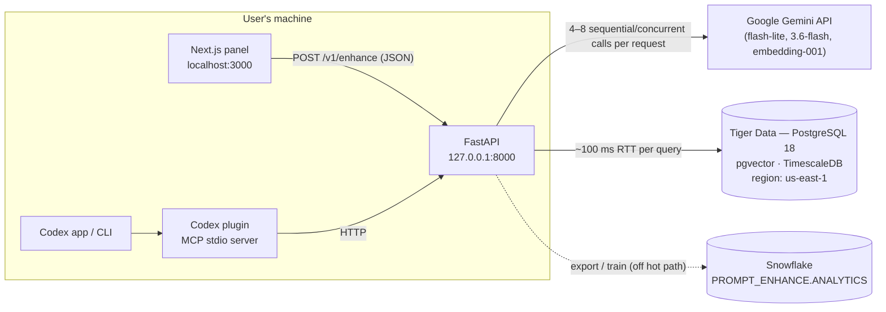
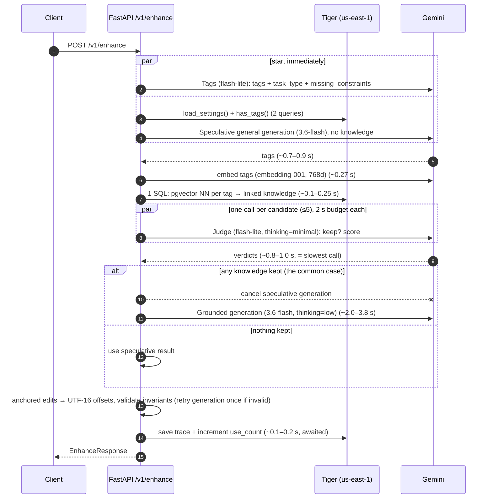

# Agentcomplete — Architecture and Performance Notes

This document describes how the system is built today (October 2026), how one autocomplete request flows through it, where the time goes, and which parts can and cannot change. It was written to brief a reviewer whose job is to **make autocomplete much faster**.

**The problem in one line:** a suggestion currently takes **~4.5–6 s** end to end (p50 ≈ 4.3 s on the live backend). Ghost-text autocomplete feels broken above ~1 s. Target: **< 1 s** for autocomplete, ideally < 500 ms perceived.

---

## 1. What the product does

A single-user companion app for OpenAI Codex. While the user writes a prompt, it either:

- shows **ghost-text autocomplete** after the cursor (Copilot-style; `Tab` accepts, `Esc` dismisses), or
- asks a **multiple-choice question** whose options each carry text edits; the user previews the diff and applies one, or declines all.

Suggestions are grounded in a **knowledge base** (SKILL files, example prompts, agent graphs) retrieved via **tags**. A Codex plugin (MCP server) lets Codex fetch the refined prompt. Outcomes (accepted / declined …) are exported to Snowflake to train an acceptance classifier.

Source-of-truth docs: [`docs/brief.md`](brief.md) (product), [`docs/api.md`](api.md) (HTTP contract), [`design.md`](../design.md) (UI).

---

## 2. Repository map

```
backend/                     FastAPI service (Python 3.12+, Pydantic, psycopg 3 async, google-genai)
  app/main.py                app factory, middleware, routers, migrations on start-up
  app/config.py              settings (.env) — model names, timeouts, embed dims
  app/pipeline/              ⚡ THE HOT PATH for /v1/enhance
    run.py                   orchestration: tags → retrieve → judge → generate → validate → trace
    tags.py                  step 1: tag + task-feature extraction (LLM)
    retrieve.py              step 2: embed tags → pgvector NN over tag vectors → knowledge candidates (1 SQL)
    judge.py                 step 3: per-candidate relevance judgement (LLM ×N, concurrent)
    generate.py              step 4: suggestion generation (LLM) + anchored-edit → UTF-16 conversion
    edits.py / validate.py   UTF-16 offset maths and contract invariants
    prompts.py               system prompts for tags / judge / generate
    features.py / trace.py   derived features + per-request trace row (no prompt text stored)
  app/llm/gemini.py          structured-output + embedding wrapper, logs AI-call metadata
  app/knowledge/             ingest (summarise, tag, embed, save), repository, seed loader
  app/activity/, analytics/  logs/stats queries; Snowflake export + ML training
  app/observability/         request-id middleware, background log writers, error sanitising
  app/db/migrations/         SQL schema (Tiger Data / PostgreSQL + pgvector + TimescaleDB)
  scripts/bench_enhance.py   latency/quality bench for the pipeline (see §9)
  seed/*.md                  18 seed knowledge items
frontend/                    Next.js 16 / React 19 companion panel (shadcn/ui, Tailwind v4, TanStack Query)
  src/lib/enhance/           ⚡ client request state machine (debounce, abort, staleness), edit maths
  src/components/refine/     editor with ghost-text mirror layer, question card, diff, context inspector
  src/components/{knowledge,activity,settings}/   other tabs
  e2e/                       Playwright journeys against the live backend
plugin/prompt-enhance/       Codex plugin: MCP server (Python) + skill + local marketplace
docs/                        brief, API contract, design mockups, this file
```

---

## 3. Runtime topology



Notable physical facts:

- The **database is in us-east-1** (free Tiger tier only allows that region); the user is in the UK. **Measured round trip ≈ 100 ms per query.**
- Gemini is called over the public API from the laptop. Measured floors for a *trivial* structured call: **flash-lite ≈ 640 ms**, **3.6-flash ≈ 1.0 s**; embedding 5 short tags ≈ **270 ms**.
- One uvicorn worker, async throughout. No caching layer.

---

## 4. Life of one autocomplete request

### 4.1 Client (frontend/src/lib/enhance/use-enhance.ts)

1. Every keystroke **or cursor/selection move** updates local state, increments `prompt_revision` (text changes only), hides any visible suggestion (emitting a `superseded` outcome), and aborts the in-flight fetch.
2. After **`trigger_delay_ms` (default 400 ms, user-configurable 150–1500)** of inactivity, it sends:
   ```json
   POST /v1/enhance
   { "request_id": "req_ab12cd34ef56", "prompt": "<full prompt>", "prompt_revision": 14, "cursor": 121 }
   ```
3. A response is accepted only if its `request_id` and `prompt_revision` still match the latest input; otherwise discarded.
4. Ghost text renders only if cursor is at the end and `insert_at === prompt.length`. After display it fetches `GET /v1/traces/{request_id}` for the inspector and posts `POST /v1/outcomes` (`shown`, later `accepted`/`dismissed`/…) — both off the critical path.

**Perceived latency = debounce (400 ms) + server time (~4.5 s) + render.**

### 4.2 Server pipeline (backend/app/pipeline/run.py)



Step details:

| # | Step | Model / resource | Input | Output | Code |
|---|---|---|---|---|---|
| 1 | Tag extraction | `gemini-3.5-flash-lite`, structured JSON | full prompt | ≤ 6 kebab-case tags, `task_type`, `missing_constraints[]` | `tags.py`, `prompts.TAGS_SYSTEM` |
| 2 | Retrieval | `gemini-embedding-001` (768-d, SEMANTIC_SIMILARITY) + Postgres | tags | ≤ 5 candidates (id, title, summary, body ≤ 8000 chars, best tag similarity) | `retrieve.py` (`_RETRIEVE_SQL`) |
| 3 | Judging | `gemini-3.5-flash-lite`, `thinking_level=minimal`, **one call per candidate**, concurrent, 2 s timeout each | prompt + candidate summary | `keep`, `score`, `reason` | `judge.py`, `prompts.JUDGE_SYSTEM` |
| 4 | Generation | `gemini-3.6-flash`, `thinking_level=low`, structured JSON | prompt, cursor, allowed types, max options, kept knowledge (title + summary + ≤ 1200-char tag-relevant excerpt each), extracted features | `type` + autocomplete text **or** question/options with text-anchored edits | `generate.py`, `prompts.GENERATE_SYSTEM` |
| 5 | Validation | CPU | model output | wire `EnhanceResponse`; invalid → 1 retry → `none` | `edits.py`, `validate.py` |
| 6 | Trace | Postgres | tags, scores, step timings, derived features | 1 row in `enhance_trace` (hypertable) | `trace.py` |

The generation model decides between autocomplete and question; there is **no separate fast path for autocomplete** today — both go through the same 4-step chain and the same 3.6-flash call that has to emit a schema containing both shapes.

Retrieval tuning (in `retrieve.py`): similarity threshold **0.88** (unrelated tags score 0.75–0.86 on this embedding), 8 neighbours per tag, ≤ 5 candidates.

### 4.3 What happens to stale requests

The client aborts the fetch on every keystroke, **but the server does not detect client disconnects** — every superseded request still runs the full pipeline (4–8 Gemini calls + DB writes). While typing continuously, several pipelines can overlap, wasting quota and competing for the event loop / pool.

---

## 5. Measured latency (live, 2026-10-25)

`scripts/bench_enhance.py`, in-process (no HTTP), 9 prompts, current models:

| Prompt (cursor at end) | Total | Tags | Retrieve | Judge | Generate | Result |
|---|---|---|---|---|---|---|
| Refactor the Stripe webhook handler … backoff | 4.49 s | 875 | 542 | 850 | 2030 | question |
| Write a migration plan for our database. | 4.55 s | 768 | 518 | 945 | 2219 | question |
| Add a zero-downtime migration … NOT NULL | 5.64 s | 773 | 546 | 1024 | 3163 | question |
| Write tests for the React login form | 5.68 s | 673 | 379 | 805 | 3722 | question |
| Summarise this diff for review | 4.77 s | 807 | 531 | 1061 | 2274 | question |
| Make the API faster | 4.97 s | 824 | 448 | 915 | 2687 | question |
| Add retries to the payment client … backoff and | 4.66 s | 865 | 643 | 928 | 2123 | autocomplete |
| Write Vitest tests for the login form that check | 6.07 s | 836 | 420 | 845 | 3815 | autocomplete |
| Create a zero-downtime migration … by first | 4.63 s | 891 | 517 | 936 | 2160 | autocomplete |

Step times in ms. Over HTTP in the app, p50 ≈ 4.3 s (Activity tab). Earlier model mix (3.6-flash judge, 3.8-flash generate) was ~5.5–6.5 s.

**Floors measured on this machine:** DB round trip ≈ 100 ms · flash-lite trivial call ≈ 640 ms · 3.6-flash trivial call ≈ 1.0 s (thinking low/minimal) · embed 5 tags ≈ 270 ms.

**Where the time goes (typical 4.6 s):** tags 0.85 → embed+SQL 0.5 → judge 0.9 → generate 2.1–3.8 → trace write ~0.2. The chain is **strictly sequential** (each step needs the previous one's output), so the floor with today's design is roughly `0.65 + 0.37 + 0.65 + 1.0 ≈ 2.7 s` even with trivial outputs.

---

## 6. Why it is slow (diagnosis)

1. **Four dependent network hops to an LLM provider** per suggestion (tags → embed → judge → generate), each with ~0.3–1 s fixed overhead, plus multiple trans-Atlantic DB round trips.
2. **Generation is the largest and most variable step** (2–3.8 s): a reasoning-capable model, structured JSON with a union schema (autocomplete *and* multiple-choice fields), knowledge excerpts in the prompt (a typical request uses ~2.5 k input / ~450 output tokens across all its calls, most of it in generation).
3. **No fast path for autocomplete.** Ghost text needs a short suffix (≤ 25 words) but pays for the full tags/judge/question machinery.
4. **No caching or reuse across keystrokes.** Consecutive requests for `"…backoff"`, `"…backoff a"`, `"…backoff and"` recompute tags, retrieval and judging from scratch even though the topic hasn't changed.
5. **No streaming.** The client waits for the full JSON; nothing is shown until generation finishes.
6. **Server ignores client aborts** (§4.3), so wasted work piles up while typing.
7. **DB in us-east-1** adds ~100 ms per query (settings, has_tags, retrieval SQL, trace insert, use_count update — some awaited on the critical path).
8. **Debounce** adds 400 ms before anything starts.

---

## 7. Constraints — what must stay true

From the PRD / [`docs/brief.md`](brief.md) / [`docs/api.md`](api.md). These are requirements, not implementation details:

- **Response contract** (`schema_version: 1`): discriminated `autocomplete | multiple_choice | none`; UTF-16 positions, half-open ranges; autocomplete `insert_at === prompt.length` and text is suffix-only; questions have ≥ 2 options, unique ids, ≥ 1 non-overlapping edit each, all relative to one snapshot. Client accepts a response only when `request_id` + `prompt_revision` match the latest input. Failures are HTTP errors, never `none`.
- **Pipeline semantics required by the PRD:** (1) tags found by a *small, quick LLM*; (2) knowledge retrieved by tag via the vector DB (nearest neighbour); (3) a model reviews *each* retrieved knowledge summary against the input to decide if it is needed; (4) generation from filtered knowledge + input; general enhancement allowed when nothing is retrieved/kept.
  *Interpretation latitude:* these steps must exist, but they don't all have to run **per keystroke** or **in series** — e.g. caching, running retrieval/judging for questions only, or judging asynchronously would need a product decision but are not obviously ruled out.
- **Never invent project facts, sources or preferences**; missing information becomes a question.
- **Logging (decision D1):** metadata only — no prompts, knowledge bodies or model responses in logs/traces. **Retention (D2):** 30 days. Any cache that stores prompt text must be in-memory/ephemeral or explicitly approved.
- **Stack:** Python 3.12 + FastAPI + Pydantic backend; Gemini for tags/embeddings/judging/generation (hackathon sponsor requirement); Tiger Data for storage; Snowflake for the classifier on derived features only.
- Single user, local. Secrets stay on the backend.

---

## 8. Optimisation directions (candidates, not yet evaluated)

Listed roughly by expected impact. Numbers are estimates from the measurements above.

| Idea | Expected effect | Notes / trade-offs |
|---|---|---|
| **Dedicated autocomplete fast path**: when cursor is at the end, call a small model (flash-lite, no thinking, tiny autocomplete-only schema, short `max_output_tokens`) directly, in parallel with the full pipeline; show ghost text as soon as it arrives | 4.5 s → **~0.7–1.0 s** | Need to decide how knowledge grounding applies (see next row); full pipeline can still produce questions later |
| **Topic cache across keystrokes**: cache tags → candidates → verdicts keyed on a coarse prompt signature (e.g. normalised prefix or embedding of first N words); reuse while the topic is stable | removes ~2.2 s of tags+retrieve+judge from most requests | In-memory only (D1). Invalidate when tags change or knowledge is edited |
| **Use cached kept-knowledge in the fast path** (from the previous request on the same draft) | grounded ghost text at fast-path speed | First request of a draft is ungrounded or slower |
| **Stream generation** (`generate_content_stream`) and stream the suffix to the client (SSE / chunked JSON) | time-to-first-token instead of full completion | Contract currently returns one JSON object; would need an additive streaming endpoint |
| **Cancel server work on client disconnect** (check `request.is_disconnected()` / cancel the pipeline task) or a server-side "latest revision wins" per client | less contention while typing, lower cost | Small change in `api/enhance.py` / `run.py` |
| **Merge tags + judge or judge + generate** into fewer calls; or score candidates with embeddings and only LLM-judge for questions | −0.6 to −1.0 s | Must still satisfy "review each knowledge" — could be one call that judges all candidates at once |
| **Embed the prompt instead of / in parallel with tags** for retrieval | −0.85 s (skip waiting for tags) | Tags still needed per PRD; could run concurrently and merge |
| **Move off the trans-Atlantic DB hops**: keep tag vectors + candidate summaries in process memory (18 items / ~50 tags today), write traces fire-and-forget | −0.2–0.4 s | Tiger stays the source of truth; memory is a read-through cache |
| **Smaller generation prompt**: drop body excerpts for autocomplete, shorter system prompt, autocomplete-only schema, cap output tokens | −0.5–1.5 s on generate | Grounding quality vs speed |
| **Lower debounce** (e.g. 150–250 ms) once requests are cheap and cancellable | −150–250 ms perceived | More requests |
| **Context caching** for the long system prompts (Gemini explicit/implicit cache) | small–medium | Depends on provider caching behaviour |
| **Region**: Tiger paid tier in eu-west, or run the backend near us-east-1 | −80–90 ms per DB query | Cost |

---

## 9. How to measure and verify

Run everything locally (credentials are in the git-ignored `.env`; see `README.md`).

```bash
cd backend && PYTHONPATH=. uv run python scripts/bench_enhance.py
```
Prints total and per-step latency, kept knowledge and the suggestion for 9 prompts (override models with env vars, e.g. `GENERATE_MODEL=gemini-3.5-flash-lite`).

In the app, the **Activity** tab shows p50 latency and a per-request timeline of every Gemini call; the Refine inspector shows per-step timings for the latest suggestion.

Correctness gates that any optimisation must keep green:

```bash
cd backend && uv run pytest -q
```
```bash
cd frontend && pnpm test && pnpm test:e2e
```
(`test_enhance_live.py` covers contract invariants against real Gemini; Playwright covers ghost text accept, question → diff → apply, decline, Send to Codex.)

---

## 10. Data model (Tiger Data)

| Table | Purpose | Notes |
|---|---|---|
| `knowledge` | id, kind (skill/prompt/graph), title, body, summary, use_count | 18 seed rows |
| `tag` | name (unique), `embedding vector(768)` | HNSW index, cosine; ~50 rows |
| `knowledge_tag` | many-to-many | |
| `enhance_trace` | per-request tags, candidate scores, step timings, derived features | hypertable, 30-day retention, no prompt text |
| `outcome_event` | shown/accepted/declined/dismissed/superseded + derived features | hypertable, exported to Snowflake |
| `api_call_log`, `ai_call_log` | request metadata, model, latency, tokens, sanitised error | hypertables, 30-day retention; written in background tasks |
| `app_settings`, `handoff`, `analytics_state` | single-row config, latest refined prompt, classifier state | |

Ingest (`POST /v1/knowledge`, SSE): summarise ∥ tag (LLM) → embed new tags → one transaction inserting knowledge, tags and links. Tags reuse existing names at similarity ≥ 0.9.
