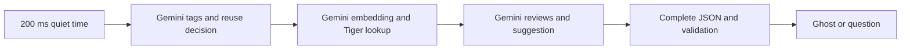
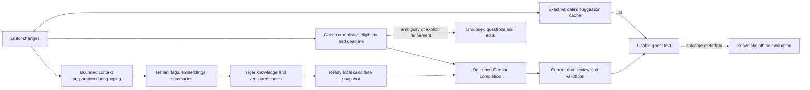

# Latency architecture audit

25 October 2026. Current working tree, including its pre-existing uncommitted optimizations. Investigation by the main agent and three research subagents. Application code and service settings were not changed. New live work consisted of read-only Tiger Data queries and SQL experiments; Gemini latency figures come from existing benchmark files and their matching historical provider logs.

**The two-second delay is primarily an architectural dependency problem, with a meaningful Gemini response-time floor.** Every new draft normally waits for a remote tag classifier, then embedding/retrieval, then another generative call. The implementation already contains many reasonable optimizations. A sponsor-preserving subsecond design needs to remove work from that sequence, not merely add more caches around it.

There is also a concrete, smaller SQL issue: a read-only query-shape experiment reduced server execution from **89.84 ms to 1.52 ms median**. That is actionable, but it cannot make the present whole pipeline subsecond.

## Evidence and attribution

The most recent linked-edit fixture has nine requests: seven autocompletes and two questions. In-process pipeline median is **2,225 ms**, excluding browser-to-backend HTTP. The following are **mean contributions over those same nine requests**, so they can be compared and added; they are not stage medians or a production latency distribution.

| Contribution | Mean | Share of pipeline time | Attribution |
|---|---:|---:|---|
| Gemini tag extraction / context comparison | 783.6 ms | 34.4% | Avoidable serial application dependency; individual call includes provider and network time |
| Embedding + pool + Tiger query + result processing | 350.6 ms | 15.4% | Mixed stage; some requests reuse context and spend zero here |
| Gemini candidate review + generation | 1,054.8 ms | 46.3% | Provider call plus output/schema workload; current method waits for completion |
| Outside those spans | 88.4 ms | 3.9% | Settings and orchestration; not fully instrumented |
| Browser quiet-time delay, additional | 200 ms configured | Excluded above | Confirmed live settings; actual paint is not measured |

Sources: [linked-edit observations](evidence/latency-edits-linked.json), [recomputed arithmetic](evidence/latency-audit-summary.json), [live read-only diagnostics](evidence/latency-audit-diagnostics.json). The logical judge span is zero because judging shares the generation call; it must not be counted twice.

The critical sequence is visible in [run.py:133](/Users/mattlo/Desktop/oxhack-2026/backend/app/pipeline/run.py:133):



Two useful counterfactuals, computed by subtracting stages **within each request before taking the median**:

- Making the entire retrieval stage free leaves **1,812 ms median pipeline latency**.
- Making both tags and retrieval free leaves **1,053 ms median pipeline latency**; for the seven suffix requests alone, **1,000 ms**. Add the browser delay to estimate the remaining budget pressure. These are arithmetic bounds for this sample, not predictions of a modified system.

Even the three exact-repeat autocomplete examples in the earlier optimized benchmark have an 802 ms API median. Adding the current 200 ms delay reaches 1,002 ms before rendering. Exact repeats and typing through an already displayed suffix are useful special cases, but cannot establish a subsecond experience for new text.

### What the fresh database investigation established

The live corpus contains **61 tags and 29 knowledge records**. Eight warm `SELECT 1` probes have an **85.88 ms median** from this workstation. This measures a client/database round trip, not pure network RTT or query CPU. Connection establishment is separate and is normally amortized by the existing connection pool.

Current retrieval unnests text representations, then casts each query vector inside the distance expression:

```sql
FROM unnest(%(vectors)s::text[]) WITH ORDINALITY AS q(v, i)
-- inside the lateral scan:
ORDER BY embedding <=> q.v::vector
```

We tested the same query with the conversion at the array boundary:

```sql
FROM unnest(%(vectors)s::vector[]) WITH ORDINALITY AS q(v, i)
-- inside the lateral scan:
ORDER BY embedding <=> q.v
```

Both occurrences of the distance expression change, including the selected similarity. A third variant materialized converted query vectors in a CTE.

| Read-only SQL variant | Server execution median | Client EXPLAIN median |
|---|---:|---:|
| Current text-array query | 89.84 ms | 200.00 ms |
| Typed vector array | 1.52 ms | 91.23 ms |
| Materialized converted vectors | 1.82 ms | 93.15 ms |

There were four shuffled observations per variant, using four existing stored vectors and the same corpus. All twelve result comparisons matched after normalizing unspecified candidate ordering. This strongly supports redundant per-row text conversion as a cause; we did not profile PostgreSQL expression execution directly. EXPLAIN adds overhead, this is one small fixture, and the client difference must not be advertised as a measured whole-application gain.

The plans use sequential scans at this tiny size. An HNSW index already exists. Installing another vector engine or forcing the index is not the first move. Apply and regression-check the typed-vector query first, then remeasure real retrieval. Keep Tiger Data as the source of truth. [Query code](../backend/app/pipeline/retrieve.py), [reproduction script](research/collect-latency-diagnostics.py).

### What the provider evidence establishes

Read-only inspection of the most recent 300 AI log records found successful enhancement calls averaging 771.9 ms for tags (n=78), 275.0 ms for embedding (n=60), and 1,037.8 ms for generation (n=87). This window mixes benchmarks/tests and schemas, so it is corroboration, not production telemetry or a new controlled provider benchmark.

Joining historical request IDs back to the linked-edit fixture reveals that its seven suffix generations emit a **median 198 output tokens** and take **971 ms median** at the provider wrapper. Their user-facing suffix is capped at 25 words: review objects and JSON account for additional work. The two questions emit a median 328.5 tokens. Output-token reductions are therefore worth testing; their exact effect on latency is unmeasured.

The repository does not record TTFT, first useful suffix, thought tokens, provider cache hits, queueing or finish reasons. We cannot distinguish Google queuing from prefill, decoding, thinking and network time. Calling this simply “Gemini is slow” overstates the evidence. The app controls how many dependent calls it makes and what it asks them to emit.

Snowflake is outside the enhancement request path. It exports outcomes and trains a classifier. It is not causing the measured two-second response.

## Recommended architecture

Make fast suffix completion and deeper clarification separate latency contracts. Retain all sponsors:



“Current-draft review” here is part of the one generation call plus local validation, not another synchronous model call. Gemini can still review every selected candidate. Tiger remains authoritative. Snowflake evaluates quality and triggering without a warehouse lookup per keystroke.

The key changes, in order:

1. **Fix the measured SQL conversion issue and instrument the missing spans.** Small scope, directly supported by the experiment. Split embedding, pool wait, query execution/client round trip, settings refresh, generation and validation timing.
2. **Remove fresh remote tag extraction from eligible autocomplete requests.** Use current editor state and a conservative local gate, with one Gemini suffix-or-none call. Classification, missing-constraint analysis and full questions remain available on the slower path. The current tag call has several responsibilities, so deleting it without replacing routing and applicability checks would be a behavior regression.
3. **Prepare context before the final pause.** At this corpus size, evaluate a versioned local mirror of Tiger's tags, associations and compact knowledge summaries, plus bounded asynchronous semantic preparation. Lexical matching can nominate candidates; it is not proof of relevance. A direct draft embedding is another experiment, but still costs a remote call and needs a correctly rebuilt/calibrated retrieval representation. Do not compare document-query embeddings against the existing semantic-tag vectors without validation.
4. **Reduce emitted review metadata.** Try an ordered compact review representation before the suffix, retaining one decision per candidate. A score vector removes repeated keys; however, current `keep=false` can independently reject a high score, so dropping that boolean changes semantics unless replaced explicitly. Also test fewer, better candidates. Compare relevance recall and unsupported assumptions as well as token counts.
5. **Expand safe exact reuse, then test streaming.** Existing visible-ghost type-through reuse already works. New opportunities are exact prior-state caching and salvaging a single in-flight suffix only when it exactly matches characters typed meanwhile. For streaming, measure first usable, valid suffix rather than first JSON byte. Reviews and partial-word metadata must be available before acceptance; anchored question edits stay atomic.
6. **Test provider options after the dependency reduction.** The current model is already Flash-Lite with minimal thinking and a reused client. Benchmark the SDK's optional aiohttp transport, supported Google models, deployment geography and Priority independently. Priority is documented for the Interactions API and has no subsecond guarantee; it is not a field to blindly add to the existing generateContent wrapper. [Google Priority](https://ai.google.dev/gemini-api/docs/priority-inference), [SDK transport option](https://github.com/googleapis/python-genai#faster-async-client-option-aiohttp).

Context must be versioned and checked against the current draft. Negation, technology changes and new requirements can invalidate old candidates. Reviewing old candidates can reject irrelevant items but cannot recover newly relevant missing items; measure retrieval recall. A timeout/abstention should be counted as a missed suggestion, not a successful fast completion. Preserve existing revision, UTF-16, IME and edit validation.

If ready context is missing, choose and evaluate an explicit policy: defer to the slower grounded path, or offer only a general wording continuation without assuming facts. Universal cold, fully grounded subsecond results are not supported by current measurements. If a single compact Gemini call cannot fit the target percentile, prepared or local completions must cover the instant path, with Gemini still providing preparation and deeper refinement. Google open-model serving is a possible longer-term sponsor-compatible option, but brings a separate serving/training project.

## Lessons from Cursor, Google and recent papers

| Source | What transfers | What does not |
|---|---|---|
| [Cursor Fusion, January 2025](https://www.cursor.com/blog/tab-update) | Specialized next-action prediction, serving engineering, reusable editor state. Cursor reports **260 ms server p50**. | This is a custom model and serving system, not browser p95 or a general managed-API RAG benchmark. |
| [Google Smart Compose engineering](https://research.google/blog/smart-compose-using-neural-networks-to-help-write-emails/) and [KDD 2019 paper](https://research.google/pubs/gmail-smart-compose-real-time-assisted-writing/) | Narrow task, confidence-based triggering, cached context and specialized inference. The original engineering target was approximately 100 ms. | The historical TPU/RNN system is not evidence that a Gemini instruction call should take 100 ms. |
| [NES, FSE 2026 industry paper](https://arxiv.org/abs/2508.02473) | Specialized prediction from edit history; reports about 250 ms serving. | Requires its own models/serving. Reported acceptance normalization and average latency differ from this app's metrics. |
| [SpecAgent, ACL 2026](https://arxiv.org/abs/2510.17925) | Compute anticipated repository context during indexing, before a user requests completion. This is particularly relevant to moving context work out of the pause. | Its full-function generation remains multi-second; do not copy its improvement percentages into a suffix budget. |
| [Predictive Prefetching for RAG, ICML 2026](https://arxiv.org/abs/2605.17989) | Predict when retrieval will be needed and overlap preparation with other useful work. | Its internal-state predictor is not exposed by Gemini's public API; an app-side typing heuristic is an adaptation, not reproduction. |
| [Tool-Intent Stabilization, June 2026 preprint](https://arxiv.org/abs/2606.20113) | Investigate when a retrieval query becomes sufficiently determined before the user finishes typing. | Not all inputs stabilize early. Its QA results do not establish the hit rate for this editor. |
| [Cursor speculative edits](https://cursor.com/blog/instant-apply), [speculative decoding, ICML 2023](https://proceedings.mlr.press/v202/leviathan23a.html), [DEdit, September 2026 preprint](https://arxiv.org/abs/2609.38510) | Draft/verify efficiently when the serving engine supports it; reuse predictable output. | A mostly unchanged file rewrite is different from 25 unknown words. Hidden-state/draft-verification methods cannot be implemented by making two ordinary Gemini API calls. |

The detailed research notes cover additional papers, exact provider compatibility, source versions, algorithm assumptions and experimental limitations. These are design evidence, not promises of speedups for this system.

## Decision experiment and acceptance criteria

Use **last input to first usable validated ghost text** as the product metric. Also record request-to-result separately. With a 200 ms trigger, the entire remaining route has less than 800 ms to achieve a subsecond visible result. An illustrative budget is 200 ms trigger + 50 ms local lookup/orchestration + 650 ms complete Gemini response + 50 ms validation/paint = **950 ms**. The 650 ms allocation is a target, not an observed reliable percentile. Provider-wrapper time already includes its network transit; do not count it again.

Run randomized paired experiments against a frozen corpus and real timestamped typing traces. First compare current path, typed SQL, one-call completion, prepared-context completion and compact reviews. Separate first visit, exact repeat, append edits, negation, platform changes, Unicode/IME, backspace/retype and questions. Report p50/p95 with sample counts and uncertainty; the current nine-request fixtures are insufficient for a tail-latency claim.

Track useful coverage, acceptance at matched coverage, retained accepted characters, invalid/stale outputs, deadline misses, cancellations, retries and cost per accepted suggestion. Record first token, first useful suffix, validation completion and paint; model IDs, schema version, actual candidate counts and cache hits are essential. No prompt payload logging is needed for ordinary telemetry. A fixed synthetic/consented test set can support quality evaluation.

For concurrency, measure pool wait and background logging pressure. AI/API log tasks currently have an unbounded pending set and share the foreground database pool; trace persistence can block once its queue reaches 256. Those are tail-latency risks under load/outage, not established causes of the current median. Separate bounded observability handling after the main path is improved.

Use Snowflake to evaluate trigger policies carefully: current training treats `superseded` as rejection and includes post-generation features. Fast typing is not necessarily a negative quality label, and final scores/latency are unavailable to a pre-request gate. Create a separate pre-request feature set before deploying a learned trigger. [Training labels](../backend/app/analytics/train.py), [features](../backend/app/pipeline/features.py).

## Deliverables and reproduction

- [Gemini/provider research](research/gemini-latency-audit.md)
- [Retrieval, SQL and systems research](research/retrieval-systems-audit.md)
- [Cursor/Google and autocomplete architecture research](research/autocomplete-architecture-audit.md)
- [Read-only diagnostic script](research/collect-latency-diagnostics.py)
- [Fresh SQL/metadata evidence](evidence/latency-audit-diagnostics.json)
- [Arithmetic from existing benchmarks](evidence/latency-audit-summary.json)

From the repository root, with the existing backend environment and configured credentials:

```bash
backend/.venv/bin/python docs/research/collect-latency-diagnostics.py
```

The script uses database-enforced read-only transactions and a statement timeout, invokes no models, and saves metadata only. It does not mutate knowledge, settings or provider configuration. Rerunning replaces its diagnostic JSON. No new end-to-end/UI benchmark or application test suite was run because this investigation changes only research artifacts.
