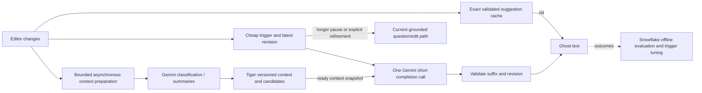

# Autocomplete architecture: why the editor still waits, and what to test

Research and source inspection: 25 October 2026. This report changes no application code, settings, providers, or running services. Line references describe the working tree inspected today. Existing benchmark files are historical observations, not measurements newly run for this report.

## Diagnosis

The remaining delay is mainly the cost of making an interactive completion wait for a fresh reasoning-and-retrieval workflow. The browser is already fairly lean. It waits 200 ms, then the server usually performs **tag classification → embeddings/Tiger retrieval → candidate review and generation**. The user sees nothing until all of the generated JSON is received and validated. A faster database or shorter debounce alone cannot remove the two dependent generative calls.

The distinction between “API under one second” and “usable ghost text under one second after the last key” matters. Existing evidence reports 710–853 ms API latency for three favorable exact-repeat autocomplete cases. Add the current 200 ms debounce and those become at least 910–1,053 ms before browser rendering; these are arithmetic illustrations, not measured browser timings. The nine-request incremental run reports a 1,933 ms median API response, while a later expanded-corpus linked run reports a 2,225 ms in-process pipeline median, excluding browser-to-backend HTTP. None establishes a production p95. See [performance evidence](/Users/mattlo/Desktop/oxhack-2026/docs/performance.md:7), especially lines 32–40 and 71–73.

Sponsor retention is compatible with a different critical path: Gemini can generate completions and prepare context; Tiger can own knowledge and precomputed candidate sets; Snowflake can evaluate quality and tune triggering asynchronously. Retaining a sponsor does not require invoking every sponsor, or every AI capability, after every pause.

## Current code: what is already good and what remains expensive

| Finding | Code evidence | Consequence |
|---|---|---|
| Default debounce is already 200 ms. Each edit cancels the timer and active fetch. | [defaults.ts:2](/Users/mattlo/Desktop/oxhack-2026/frontend/src/lib/settings/defaults.ts:2); [use-enhance.ts:143](/Users/mattlo/Desktop/oxhack-2026/frontend/src/lib/enhance/use-enhance.ts:143), lines 149–156 and 188–210 | Dropping it to 100 ms can save about 100 ms at the final pause, but may increase interrupted requests. It cannot explain or fix the remaining ~2 seconds. |
| Exact typing through a visible ghost preserves its remainder immediately. | [state.ts:79](/Users/mattlo/Desktop/oxhack-2026/frontend/src/lib/enhance/state.ts:79), lines 79–91; [use-enhance.ts:209](/Users/mattlo/Desktop/oxhack-2026/frontend/src/lib/enhance/use-enhance.ts:209) | Do not present local suffix reuse as a new optimization. It does not help before the first response becomes visible. |
| In-flight responses are discarded after any revision change; all changes interrupt the fetch. | [state.ts:102](/Users/mattlo/Desktop/oxhack-2026/frontend/src/lib/enhance/state.ts:102), lines 163–165; [use-enhance.ts:198](/Users/mattlo/Desktop/oxhack-2026/frontend/src/lib/enhance/use-enhance.ts:198) | Correctness is protected, but an old response that exactly predicts characters typed meanwhile cannot currently be salvaged. |
| Cancellation reaches the backend; the Gemini client is reused. | [enhance.py:30](/Users/mattlo/Desktop/oxhack-2026/backend/app/api/enhance.py:30); [gemini.py:18](/Users/mattlo/Desktop/oxhack-2026/backend/app/llm/gemini.py:18), lines 47–57 | These are implemented. Cancellation of local work does not prove remote inference instantly stops or becomes free. |
| All rendering waits on the full JSON response. | [client.ts:51](/Users/mattlo/Desktop/oxhack-2026/frontend/src/lib/api/client.ts:51); [use-enhance.ts:106](/Users/mattlo/Desktop/oxhack-2026/frontend/src/lib/enhance/use-enhance.ts:106); [gemini.py:47](/Users/mattlo/Desktop/oxhack-2026/backend/app/llm/gemini.py:47) | There is no first-useful-suffix event, streaming response, or measured gap between first token and completed result. |
| Fresh retrieval starts after tags; generation starts after retrieval. | [run.py:133](/Users/mattlo/Desktop/oxhack-2026/backend/app/pipeline/run.py:133), lines 133–156 | Caches help repeat states, but brand-new text still pays serial work. |
| The tag call also decides continuation eligibility and reuse of previous context. | [tags.py:22](/Users/mattlo/Desktop/oxhack-2026/backend/app/pipeline/tags.py:22), lines 51–95; [run.py:71](/Users/mattlo/Desktop/oxhack-2026/backend/app/pipeline/run.py:71) | Even when the user only wants a tiny continuation, the current architecture waits on remote classification before generation. |
| Candidate review and generation are already fused; compact completion uses a smaller schema and minimal thinking. | [complete.py:75](/Users/mattlo/Desktop/oxhack-2026/backend/app/pipeline/complete.py:75), lines 127–147 | Do not re-propose removing the standalone judge. Reviews precede suffix text, so they also delay useful content in a streamed version. |
| Whole generation can be retried once for application validation failure. | [run.py:80](/Users/mattlo/Desktop/oxhack-2026/backend/app/pipeline/run.py:80) | A malformed edit or review list can almost double the generative portion. Streaming does not make an invalid result acceptable. |
| Previous-request context is stored only at the end of enhancement and only when candidates exist. | [run.py:167](/Users/mattlo/Desktop/oxhack-2026/backend/app/pipeline/run.py:167); [context.py:52](/Users/mattlo/Desktop/oxhack-2026/backend/app/pipeline/context.py:52) | Canceled requests do not publish completed-request context for the next revision. Existing stage caches may still help, so this is not a claim that all earlier work is lost. |
| Rendering has no ghost fade delay; draft saving is already batched. | [prompt-editor.tsx:98](/Users/mattlo/Desktop/oxhack-2026/frontend/src/components/refine/prompt-editor.tsx:98); [use-enhance.ts:274](/Users/mattlo/Desktop/oxhack-2026/frontend/src/lib/enhance/use-enhance.ts:274) | No evidence supports blaming React for seconds of delay. `scrollIntoView` in the layout effect is worth profiling only if browser traces show input/layout stalls. |

## What Cursor and Google actually demonstrate

These systems solve different prediction problems. **Suffix completion** predicts words after the current cursor. **Next-edit prediction** predicts both where and how to change existing code. **Query autocomplete** retrieves/ranks likely search queries. Agentcomplete mostly performs natural-language suffix completion plus explicit clarification edits; it does not currently model an IDE edit trajectory. Benchmarks across these tasks are not interchangeable.

| Primary source | Evidence and limit | Applicable lesson |
|---|---|---|
| [Google, Smart Compose engineering post, May 2018](https://research.google/blog/smart-compose-using-neural-networks-to-help-write-emails/) | Google states an ideal per-keystroke response within 100 ms, and reports reducing average serving latency from hundreds to tens of milliseconds using a tailored model and TPU inference. This is historical internal serving, not a Gemini API guarantee. | Optimize the narrow completion task and its serving path explicitly. |
| [Gmail Smart Compose, KDD 2019](https://arxiv.org/html/1906.00080), §§3.3–3.4, 4 | Streaming RPC sessions, sticky server assignment, cached prefix hidden states, context encoded once, and confidence-based triggering. Evaluation compares exact match at equal coverage. TPUv2 p90 latency is reported relative to CPU (0.10×), not as an end-to-end browser SLA. | Persistent reusable state and abstention matter. HTTP connection reuse alone does not provide provider-side hidden-state reuse. |
| [Cursor, Fusion Tab model, January 2025](https://www.cursor.com/blog/tab-update) | Cursor reports 260 ms server p50 versus 475 ms for its earlier custom sparse model. Fusion predicts edits and jumps and uses a 13,000-token context. These are vendor-reported numbers; no comparable browser p95 or Gemini workload is given. | A purpose-trained prediction model differs substantially from a general instruction pipeline. A large context is not inherently fatal if inference is engineered for it. |
| [Cursor, online RL, September 2025](https://prod.cursor.com/blog/tab-rl) | Cursor reports 21% fewer suggestions with 28% higher acceptance rate after online policy optimization. It explicitly treats knowing when to abstain as a product objective. This does not disclose enough to reproduce its serving latency. | Measure accepted useful output and interruptions, not just how often a response appears. Snowflake is useful for this feedback loop without an online warehouse call. |
| [Google Search autocomplete explanation, October 2020](https://blog.google/products-and-platforms/products/search/how-google-autocomplete-predictions-work/) | Google describes matching common/trending searches and contextual ranking, including language, geography and freshness. The article does not disclose a complete current implementation or establish that Google uses a specific trie design. | A fast precomputed phrase/candidate layer is a valid product strategy; it cannot be equated with unrestricted grounded generation. |

## Recent research worth applying selectively

| Paper / primary source | What it establishes | Relevance here |
|---|---|---|
| [SpecAgent, v2 April 2026](https://arxiv.org/html/2510.17925v2), §§4.1, 6, Table 1 | Moves repository exploration and anticipated-context construction to indexing time. On its function-completion benchmark, SpecAgent reaches 27.86%/27.96% pass@1 for two Qwen models; inference still takes 4.55/5.89 s, with ~49 s preprocessing. The paper explicitly discusses future-context leakage and refresh costs. | Strongest architectural match: prepare reusable context outside the user pause. It is evidence for reducing retrieval work on the critical path, **not evidence of subsecond generation**. Gemini can perform offline preparation and Tiger can store versioned artifacts. |
| [NES, FSE Companion 2026 / March 2026 revision](https://arxiv.org/html/2508.02473v2), §§3.5, 4.2.3, 5 | Dedicated location/edit models, Qwen3-4B post-training, vLLM, prefix caching and n-gram speculative decoding. Authors report average production latency around/under 250 ms; this is not a p95 guarantee. The reported 43.44% edit “equivalent acceptance rate” multiplies raw acceptance by accepted lines and is not ordinary accept/shown. | Separate fast location/intent decisions from heavier edits; measure correctly. Model-serving techniques require inference control not exposed by the inspected Gemini wrapper. |
| [Next Edit Prediction, August 2025](https://arxiv.org/html/2508.10074v1) | Formulates predicting edit location and content from interaction history, with 3,211 fine-tuning samples and a 210-commit benchmark. Smaller specialized models improve after fine-tuning. Commit-derived trajectories are a proxy for real editor behavior. | Useful if the product expands into proactive edits. Current prompt strings and previous request IDs are not equivalent to editor trajectory data; do not add location-prediction machinery just to complete a phrase. |
| [Cursor speculative edits, May 2024](https://cursor.com/blog/instant-apply) and [EfficientEdit, June 2025](https://arxiv.org/html/2506.02780v1) | Cursor reports ~1,000 tokens/s on a specialized 70B full-file rewrite model. EfficientEdit reports up to 10.38×/13.09× versus autoregressive decoding on two edit benchmarks by reusing old code and verifying drafts. Both exploit output that is largely already known. | The app emits at most 25 new words, not a mostly unchanged file. These speedups must not be transferred to its unknown suffix. Client-side exact-prefix reuse is useful but is not token-level speculative decoding. |
| [PIE, ICLR 2025](https://seed.bytedance.com/en/public_papers/let-the-code-llm-edit-itself-when-you-edit-the-code) | Repairs positional information in cached keys after code edits; authors report over 85% computational-overhead reduction on their DeepSeek-Coder/RepoBench-C experiments. | Relevant to a future model-serving implementation, not an optimization available through the current closed Gemini request API. |
| [DEdit, September 2026 preprint](https://arxiv.org/abs/2609.38510) | A diffusion-based draft editor improves speculative-decoding acceptance; reported greedy-decoding macro-average speedups are 5.72× and 5.97× on Qwen3-4B/8B across seven benchmarks. This is recent preprint evidence, not an autocomplete deployment result. | Track it if custom serving becomes viable. It does not remove network round trips, tag classification, or RAG dependencies in this application. |
| [Speculative RAG, ICLR 2025](https://openreview.net/pdf?id=xgQfWbV6Ey) | Parallel small-model RAG drafts are verified by a larger model on QA benchmarks. | Do not automatically translate this into multiple Gemini calls per 25-word suggestion: a draft-plus-verifier cascade can add another serial round trip. Benchmark against the existing single review/generation call first. |

## A sponsor-preserving design to test

This is a proposed architecture, not an implemented diagram. It changes the online dependency graph rather than changing sponsor identity.

### Experiment A: one-call completion path

Make short suffix generation a separate latency contract from question/edit generation. For high-confidence unfinished text, call Gemini once with the exact current draft and a small ready context snapshot. Return a short suffix or abstain. Retain explicit questions and full retrieval for ambiguity, missing constraints, and longer-pause refinement.

The current backend already has a compact suffix schema; the experiment removes its dependency on a **fresh remote tag classification**, not its existing output simplification. Start with a deliberately narrow completion gate (for example, clearly unfinished phrases) and shadow-test against the current pipeline. A deterministic English suffix regex cannot replace multilingual semantic classification universally. Complete or ambiguous drafts must not silently acquire new requirements to make the fast path look successful.

If precomputed context is unavailable or invalid, test two clearly distinguished policies: abstain/defer to the full path, or allow only general wording completion from the draft. Evaluate their grounding and coverage separately. The latter is a product quality change, not a free optimization.

### Experiment B: prepare retrieval before the final pause

Decouple context preparation from the request that returns the visible suggestion. Begin bounded background preparation after a meaningful word/clause boundary or a stable session topic, while the user continues typing. Publish a candidate snapshot as soon as preparation finishes, without waiting for an unrelated old generation to finish. Use a latest-only queue and an explicit maximum background request rate.

Keep candidate snapshots versioned by session, knowledge revision, model configuration and source text. A changed platform, a negation, a new requirement or expired evidence must invalidate or refresh the relevant snapshot. Relevance review against the **current** draft remains necessary. Simple topic similarity is not proof that the candidate set remains sufficient. A current-draft review can reject old candidates but cannot discover newly relevant missing ones; evaluate recall loss explicitly.

The initial experiment should prefetch candidates only. Generating several speculative suffix branches multiplies quota use and cancellation waste; add it only if measured prefix-hit rates justify the extra calls. This is application-level work scheduling, unlike the model-level speculative decoding in the papers.

### Experiment C: expand safe reuse without relaxing revision correctness

1. Add a small session-local cache of completed, validated suggestions for exact prior editor states. This can make backspace/retype and revisiting a cursor state immediate. Key by full prompt, cursor/selection, settings, knowledge version, models and schema. Suppress explicitly dismissed results; expire entries; create appropriate current request metadata while retaining provenance.
2. Separately test retaining **one** in-flight completion across append-only typing. If the old snapshot is `P`, current text is exactly `P + A`, and returned suffix `S` starts exactly with `A`, display only `S.slice(A.length)` after validating both snapshots and UTF-16 boundaries. Reject on any interior edit, selection, composition, deletion, settings change, knowledge change or mismatch.
3. Do not rebase multiple-choice edits. Their exact anchors and user decision context require the existing strict snapshot behavior.

The second change deliberately trades some cancellation savings for salvaging useful work. It needs a bounded deadline and request count; it must not allow an old request to block a newer useful request. Existing visible-ghost type-through reuse stays as it is.

### Experiment D: stream only if it produces a useful, valid earlier result

Gemini documents [structured-output streaming](https://ai.google.dev/gemini-api/docs/structured-output); SDK/API compatibility must be tested for the currently deployed model and endpoint. A browser streaming transport alone saves nothing if the backend still awaits `generate_content` and JSON validation.

Current schemas put candidate reviews before the suffix, and `completes_partial_word` follows the text. Those fields affect whether and how the suffix can be displayed. Moving text first would change the intended review-before-generation behavior. A safe prototype should finish candidate decisions and word-joining metadata before emitting a usable word-aligned suffix segment, with explicit final validation and cancellation events. A partial segment must pass every applicable suffix/revision invariant before Tab can accept it; otherwise it is only a preview and must be measured as such. Do not silently retract or rewrite text the user already accepted. Keep questions/anchored edits atomic. Measure first **usable** suffix time separately from first byte, first token and final validated suggestion. If the stream is only ~50 ms ahead of completion, the complexity is unlikely to be worthwhile.

### Experiment E: optimize triggering against actual outcomes

The existing Snowflake path already trains an acceptance classifier. However, [train.py:13](/Users/mattlo/Desktop/oxhack-2026/backend/app/analytics/train.py:13) treats every `superseded` suggestion as negative. Fast typing can supersede useful text, so this combines quality and timing. [features.py:30](/Users/mattlo/Desktop/oxhack-2026/backend/app/pipeline/features.py:30) also includes final candidate scores, generated type and completed latency; those are unavailable to a pre-request trigger.

Create a distinct pre-request feature set (pause duration, append/delete/selection action, draft-length bucket, recent acceptance, cache readiness, composition state), and keep post-generation evaluation features separate. Learn thresholds offline in Snowflake and serve a small versioned policy locally only if export/serving compatibility is established. Do not add a synchronous Snowflake query per keystroke. Report acceptance at equal coverage, accepted characters per minute, retained accepted text, opportunities missed, flicker, and wasted provider work. A zero-suggestion policy has excellent latency and no product value.

## Latency budget and falsifiable success criteria

These are engineering allocations, **not measured predictions**:

| Route | Proposed budget after last relevant input | What must be true |
|---|---:|---|
| Existing type-through or new exact-state cache hit | ≤50 ms to paint | No provider request; exact validated applicability and no intervening invalidation. |
| New one-call short completion | 100 ms trigger + 50 ms browser/backend transit + 650 ms Gemini completion + 30 ms validation/paint + 100 ms reserve = 930 ms | Context ready, no fresh classifier, no generation retry, provider performance meets its allocation. |
| Fresh fully grounded question/edit | Measure separately; current evidence is about 2 seconds API | Do not advertise the fast-path target as universal. Bringing every cold case under one second needs a further change in inference/serving, task scope, or accepted coverage. |

Do not add stage medians and call the result a p95. Measure end-to-end distributions. With the current 200 ms trigger, the combined network/server/render work must fit inside 800 ms for a subsecond visible result. The current single generation call can already exceed that allocation; eliminating retrieval is necessary for many cases but may be insufficient.

Instrument monotonic browser timestamps for last edit, trigger, fetch start, first usable chunk, final validation and first painted ghost; attach request/revision IDs. Current `shownAt` is assigned when the response enters the reducer ([state.ts:111](/Users/mattlo/Desktop/oxhack-2026/frontend/src/lib/enhance/state.ts:111)), and `shown` is emitted in an effect ([use-enhance.ts:264](/Users/mattlo/Desktop/oxhack-2026/frontend/src/lib/enhance/use-enhance.ts:264)); neither proves pixels were painted. Browser and server clocks should not be subtracted directly.

Replay realistic timestamped typing traces, not just completed prompts sent one at a time. Cover cold starts, append-only bursts, pauses, negation, platform changes, backspace/retype, interior edits, cursor movement, Unicode/IME, accepting and dismissing suggestions. Randomize experiment order with the same knowledge snapshot. Use enough observations for meaningful p50/p95 by route, and include aborted, empty and invalid responses in outcome counts rather than silently excluding them. Evaluate text only in an explicit test corpus; ordinary telemetry can remain metadata-only.

Suggested order: **instrument → test one-call completion → prepare context asynchronously → exact-state cache and safe in-flight reuse → streaming if the measured first-useful-token gap warrants it → tune triggering**. Keep a quality gate throughout: no unstated technology, no repeated text, correct partial-word joins, no stale edits, preserved multilingual behavior, and no material reduction in useful coverage concealed by faster abstention.
